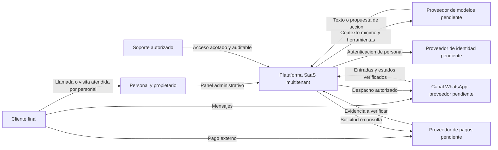
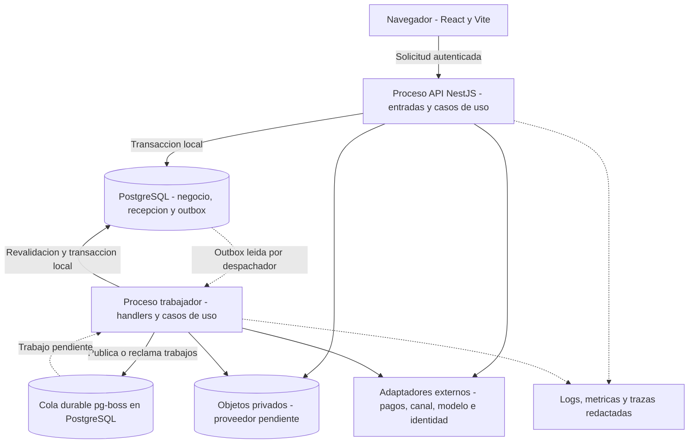
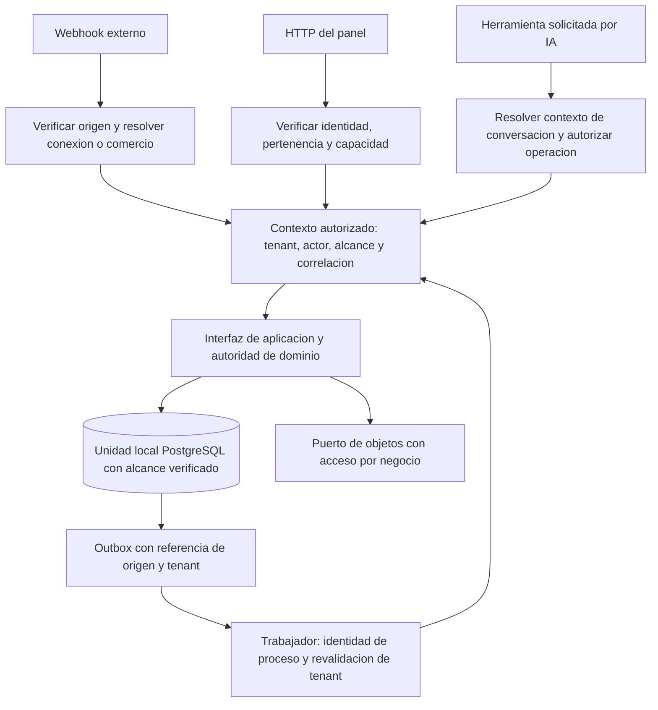

# M0.3 — Arquitectura de alto nivel

Fecha: 26 de octubre de 2026, Ecuador. Versión: 0.1. Estado: **DISEÑO PROPUESTO — PENDIENTE DE REVISIÓN DEL DESARROLLADOR**, con la elección expresa de backend registrada como aprobada en ADR-001.

## 1. Objetivo, alcance y referencias

Diseñar una plataforma comercial mantenible por uno o dos desarrolladores: monolito modular con panel React/Vite, API NestJS, PostgreSQL y trabajadores durables del mismo código base. Agenda, dinero, beneficios y permisos permanecen bajo reglas deterministas. El negocio puede operar manualmente sin IA ni WhatsApp, siempre que panel y plataforma estén disponibles; no se propone funcionamiento sin internet.

Se revisaron íntegramente las cinco entradas: [PRD](../product/PRD.md), [preguntas](../product/OPEN_QUESTIONS.md), [stack corregido](TECH_STACK.md), [decisiones M0.2](STACK_DECISIONS.md) y [validación M0.2](STACK_VALIDATION.md). Permanecen intactas. Los 12 módulos, 71 requisitos y 19 flujos funcionales mantienen su alcance.

Esta entrega contiene exclusivamente cuatro documentos: este archivo, [límites de módulos](MODULE_BOUNDARIES.md), [flujos de ejecución](RUNTIME_FLOWS.md) y [ADR](ARCHITECTURE_DECISIONS.md). Las interfaces y estados son conceptos de diseño, no endpoints, contratos definitivos, tablas, esquemas, código ni configuraciones. No se inicia M0.4. La arquitectura no demuestra que el producto ya cumpla requisitos en ejecución.

## 2. Estado de decisiones y base tecnológica

La instrucción actual del desarrollador **aprueba NestJS y TypeScript como backend**. No se reabre esa elección ni se propone un segundo backend Python. Se conservan frontend React/Vite/TypeScript, PostgreSQL principal y monolito modular por mandato de este encargo. Los detalles arquitectónicos nuevos requieren revisión.

| Componente | Referencia heredada de M0.2 corregido | Estado en M0.3 |
| --- | --- | --- |
| Frontend | React19.3, Vite8, TypeScript5.9 como base | Se conserva dirección; parches, plugins y bibliotecas por validar |
| Backend | NestJS11.2.8, TypeScript | Lenguaje/framework elegidos; versión exacta, CLI y composición pendientes de prueba |
| Runtime | Node24 LTS;24.22.1 como referencia documental | Se conserva, sin inventar actualización |
| Persistencia | PostgreSQL18;18.6 como referencia documental | Motor conservado; proveedor, permisos y parche efectivos pendientes |
| Acceso a datos | Prisma7.10.1, SQL específico y adaptador PostgreSQL compatible | Provisional hasta validar transacciones, driver, pools y formato de módulos |
| Trabajos | pg-boss12.38.0, outbox y trabajador durable | Provisional hasta pruebas; no requiere Redis por defecto |
| IA | SDK de modelos, herramientas autorizadas y orquestación explícita | Sin proveedor, modelo o framework de agentes definitivo |
| Identidad, canal, pagos, hosting y objetos | Adaptadores y contratos lógicos | Ningún proveedor, región, Graph API o servicio contratado aprobado |

No se confunden rangos documentales con prueba integrada. Se heredan las advertencias de ESM/CommonJS, generación Prisma, adaptador, decoradores, runner, peer de instrumentación y ciclo de conexiones de M0.2. No se usan por defecto ejemplos de Nest12 o Prisma8 ni se cambia una versión durante este diseño.

## 3. Principios

1. Una sola autoridad por operación: Agenda compromete capacidad; Cobros acredita dinero; Fidelización mueve beneficios; Oferta confirma cotizaciones; Conversaciones gobierna atención y despacho.
2. Cada dominio modifica solo su información mediante su interfaz; no comparte repositorios privados ni utiliza Prisma como acceso indiscriminado entre módulos.
3. Consistencia inmediata para invariantes; eventos durables para efectos secundarios. No todo requiere eventos ni una llamada HTTP interna.
4. Transacciones locales cortas en PostgreSQL, nunca abiertas esperando a cliente, LLM, Meta o pasarela.
5. Tenant, actor y permisos comprobados en toda entrada y operación; un identificador de objeto no prueba autorización.
6. Reintentos esperables, efectos deduplicados y resultados inciertos visibles. No se promete exactamente una vez extremo a extremo.
7. La IA interpreta y propone; el backend autoriza y registra. El personal puede supervisar, suspender y corregir con trazabilidad.
8. Procesos separados y límites internos antes que microservicios; sin broker, buscador o base vectorial añadidos por sofisticación.

## 4. Arquitectura lógica y contexto

El producto conecta clientes finales y personal con una autoridad operativa común. Los proveedores son externos a las transacciones locales y no son propietarios del estado comercial interno.

Este flowchart representa contexto C4: personas, sistema y sistemas externos. Una llamada es atendida por una persona y registrada en panel; no se introduce un agente telefónico IA.

La composición lógica tiene entradas (panel, webhook y ejecución durable), una capa de casos de uso transversales, dominios propietarios de estado y puertos técnicos. Un ensamblado de arranque conecta implementaciones y manejadores. Los contratos públicos no exponen clientes ORM ni permiten que un consumidor elija una tabla.

## 5. Arquitectura de ejecución y contenedores lógicos

Un contenedor C4 es aquí una unidad ejecutable o almacén, no una decisión de crear Dockerfiles. API y trabajador pueden usar el mismo artefacto lógico con puntos de arranque diferentes; la selección de módulos evita activar consumidores y temporizadores en cada proceso indiscriminadamente.

Los dos cilindros PostgreSQL representan responsabilidades diferentes dentro del motor compartido candidato, no dos bases obligatorias ni una transacción compartida automática. La API no necesita que el trabajador o un LLM respondan para confirmar una reserva manual válida sin dependencia de pago pendiente. Procesamiento intensivo y campañas no deben agotar conexiones ni bloquear consultas de agenda.

Actualización del panel: consultas devuelven estado autorizado actual y una versión lógica; notificaciones o suscripciones pueden avisar de cambios, con reconexión y relectura. El mecanismo de tiempo real queda pendiente; un aviso perdido no cambia la autoridad del backend ni hace válida una disponibilidad antigua.

## 6. Desarrollo y despliegue futuro

En desarrollo se prevén frontend, proceso API, trabajador y PostgreSQL aislado con datos sintéticos. Integraciones podrán sustituirse por dobles de prueba; también debe poder iniciarse solo el recorrido manual. Esto describe capacidades, no instala runtimes, inicia procesos o crea archivos.

En despliegue se prevén frontend estático, API y trabajador persistentes, PostgreSQL administrado y almacenamiento de objetos cuando exista contenido. No se elige proveedor, región, instancia o plan. Development, staging y production separan identidades, datos, credenciales y callbacks. El trabajador necesita ejecución durable compatible con sus tareas; no se asume que una función HTTP de duración limitada sea un proceso permanente.

Escalado razonable: varias API o trabajadores pueden ejecutar los mismos casos de uso; la coordinación de capacidad y deduplicación vive en persistencia, no en memoria de una réplica. Pools y concurrencia se presupuestarán conjuntamente. El estado recuperable no depende de disco local o sesión de proceso. Despliegue y cambios futuros de persistencia deberán ser compatibles durante transición; rollback de código no equivale a restaurar datos.

## 7. Organización modular y responsabilidad

Se proponen doce dominios de tamaño funcional y seis agrupaciones de soporte, **sin exigir dieciocho paquetes Nest ni servicios desplegables**. Oferta agrupa catálogo, valoración y cotización; Conversaciones agrupa bandeja humana, historial del canal y control de despacho. El módulo técnico de recorridos coordina únicamente casos que cruzan propietarios; no absorbe reglas de agenda, cobro o promociones.

Los dominios son Plataforma, Clientes, Oferta, Equipo, Agenda, Cobros, Fidelización, Conversaciones, Automatizaciones, Marketing, Analítica y Recepción IA. Los soportes son Recorridos de aplicación, Seguridad y contexto, Persistencia y unidad transaccional, Trabajo durable, Adaptadores externos/objetos y Observabilidad. El inventario, las interfaces, la matriz de dependencias y el grafo acíclico están en MODULE_BOUNDARIES.

## 8. Persistencia conceptual y propiedad

| Información conceptual | Autoridad | Relaciones sin acceso privado cruzado |
| --- | --- | --- |
| Negocio, sucursal comercial, acceso, políticas y suscripción SaaS | Plataforma; Equipo administra operación física de sucursales | Una referencia común no transfiere permisos ni propiedad operativa |
| Cliente, contacto y consentimiento | Clientes | Otros dominios conservan referencia y evidencia pertinente, no un CRM paralelo |
| Servicio, modalidad, valoración y cotización/aceptación | Oferta | Agenda agenda la atención; Cobros conserva dinero aplicado al concepto |
| Profesionales, horarios operativos, ausencias y recursos | Equipo | Agenda posee asignaciones y capacidad comprometida; cambios relevantes se coordinan |
| Solicitud, retención, cita, asignación y lista de espera | Agenda | Mismo motor para todos los canales |
| Solicitudes de cobro, evidencia, aplicaciones, devoluciones y conciliación | Cobros | Separados de cotización y de estado de cita; ámbito negocio/SaaS explícito |
| Paquete, puntos, membresía, referido y redención | Fidelización | Solo su autoridad altera saldos |
| Mensajes, atención, responsable, pausa e intención de despacho | Conversaciones | Única autoridad de control humano y estados de comunicación |
| Reglas/ejecuciones y campañas | Automatizaciones y Marketing respectivamente | Solicitan efectos a interfaces; no acreditan cobros, beneficios ni envíos por sí mismos |
| Proyecciones y definiciones de indicadores | Analítica | Consistencia eventual visible, sin escribir hechos de origen |

No se asigna un esquema físico. Datos de todos los propietarios pueden participar en una transacción PostgreSQL local a través de sus interfaces y una unidad de trabajo explícita; ninguno puede usar un repositorio ajeno para saltarse invariantes. Estado de operación e intención de evento/auditoría crítica se comprometen juntos. El almacén de auditoría es responsabilidad transversal de Plataforma, con puerto técnico de escritura; registrar auditoría no introduce una llamada circular a suscripción o login.

## 9. Multitenancy y propagación

Hipótesis de partida autorizada para diseño: PostgreSQL compartido y contexto de negocio verificado, con tenant lógico en la información aislada. **OQ-PRO-02 no se cierra.** Sucursal es un alcance dentro del negocio candidato; permisos por sucursal no son un sustituto del tenant. Clientes, conversaciones y archivos no se comparten globalmente por coincidir el teléfono.

El ciclo visual representa un recorrido de ejecución posterior, no una dependencia de importación entre módulos. Reglas por entrada:

- **HTTP → aplicación → DB:** identidad del personal verificada; seleccionar negocio solo entre membresías vigentes; comprobar sucursal, operación y pertenencia del objeto. Un tenant_id recibido libremente se rechaza o contrasta; no otorga autoridad.
- **Webhook → negocio → aplicación → DB:** adapter verifica procedencia según proveedor futuro y resuelve una conexión/número/comercio previamente autorizado. No confiar en el tenant incluido en el cuerpo. Si la resolución es ambigua, conservar incidencia restringida sin mutar negocio ni acusar éxito de procesamiento comercial.
- **Evento → outbox → worker:** el productor registra origen y contexto; el worker autentica su identidad de proceso, valida que el registro exista, pertenezca al tenant y autorice ese handler, y carga permisos/estado actuales. Una delegación humana revocada no se conserva por transportar un token viejo; una tarea del sistema necesita mandato explícito de regla/evento.
- **IA → herramienta:** tenant y cliente se resuelven desde conversación autorizada, no desde argumentos del modelo; herramienta aplica alcance mínimo e invoca la aplicación.

El contexto incluye actor efectivo y, si existe, actor que inició el trabajo, tipo de principal (empleado, cliente, sistema o soporte), alcance, correlación, causalidad e identidad de operación. No se copian credenciales humanas en jobs.

RLS es defensa adicional candidata, no política ya implementada: Prisma no la activa automáticamente. Revisar rol efectivo, propietarios, superusuario/BYPASSRLS, operaciones privilegiadas y posibles fugas por errores o relaciones. Si se usa contexto por conexión, limitarlo a transacción y evitar estado residual en pools. Usuarios de ejecución, evolución de datos y soporte deben tener privilegios distintos. Pruebas negativas deben ejecutarse con el rol real del runtime, no con un propietario que eluda controles.

Almacenamiento de objetos: relación tenant/objeto autorizada antes de lectura, subida o enlace temporal; adivinar una ruta no concede acceso. Jobs, cachés futuras, métricas, adjuntos y contexto del LLM requieren el mismo aislamiento. La administración de plataforma puede consultar estado operativo mínimo; leer conversaciones de un negocio necesita motivo y acceso excepcional delimitado, auditable y revocable.

## 10. Autoridad de agenda

Agenda ofrece consulta y comandos únicos para WhatsApp, llamadas registradas por empleado, atención presencial y administración. Consulta de disponibilidad es orientativa hasta validación final. Se combinan servicio y versión de condiciones de Oferta con profesional, ubicación, horario y recursos de Equipo, y con ocupación/retenciones de Agenda.

En transacción local se revalidan versiones pertinentes, permisos, capacidad y política antes de comprometer asignaciones. Dos intentos incompatibles no pueden ambos confirmar. Restricciones, coordinación de bloqueos o aislamiento se definirán físicamente después de resolver OQ-AGE-01; no se impone un único mecanismo para recurso exclusivo y capacidadN. No bastan mutex de memoria, caché, consulta previa o cola de un solo proceso. Las modificaciones de configuración de Equipo/Oferta y las confirmaciones deben competir sobre una versión/alcance de disponibilidad coherente; un simple evento eventual de ausencia no protege una reserva concurrente.

Reagendar asegura nuevo compromiso y libera el anterior en una unidad local; si falla, conserva anterior. Cancelar libera capacidad y registra motivo; devolución remota es posterior. Completar e inasistencia son transiciones autorizadas distintas; completar no marca pago verificado. Lista de espera produce ofertas, no reservas automáticas garantizadas.

Retención y cita pendiente de anticipo son conceptos distintos: una solicitud pendiente solo compromete capacidad si existe retención válida según política. La expiración se comprueba también en validación final, no depende de que un temporizador ya haya corrido. Worker de expiración y acreditación de pago compiten con control transaccional; una retención expirada no revive por un evento tardío. No se fijan duración de retención ni vocabulario definitivo de estados (OQ-AGE-03, OQ-PAY-01).

## 11. Oferta, valoraciones y dinero

Oferta mantiene cuatro modalidades autorizadas: fijo, desde, rango estimado y sujeto a valoración. El rango no limita necesariamente el importe final salvo garantía explícita. Valoración gratuita no significa servicio posterior gratuito. Se agenda con duración y profesional propios o se documenta atención directa en local con tiempos reales, sin fabricar cita previa; conflictos de registro retrospectivo quedan visibles para revisión.

Relación lógica: cliente de Clientes → servicio/valoración de Oferta → atención programada o directa en Agenda → resultado comercial no médico de Oferta → versión de cotización → decisión del cliente → reserva posterior de Agenda → movimientos de Cobros. Las referencias conservan su tenant y no convierten estos conceptos en una sola entidad.

Precio orientativo, precio confirmado por personal facultado, precio aceptado con evidencia de versión y dinero cobrado son hechos separados. Oferta es autoridad del acuerdo comercial; revisar una cotización no sobrescribe una aceptación. Decisión presencial/telefónica se registra por actor autorizado, sin inventar firma digital. La obligación de aceptación antes de iniciar y la facultad exacta para confirmar precios siguen pendientes.

Cobros puede solicitar importe conocido por valoración o anticipo con total del servicio sin definir; no calcula porcentaje sobre una estimación como si fuera total cierto. Total pendiente no es cero ni deuda definitiva. Cada pago parcial tiene concepto y aplicación, con dinero exacto y moneda; corrección conserva evidencia original. Descontar cobro de valoración del servicio requiere política aprobada y no registra nuevo ingreso. Beneficios y descuentos se validan por sus autoridades antes de fijar/aplicar el acuerdo pertinente.

## 12. Frontera de pagos

Cobros expone solicitud, registro de evidencia, consulta de estado, aplicación a concepto, devolución y conciliación. Adapter externo implementa cada proveedor futuro sin llevar reglas de agenda. Se distingue cliente→negocio de negocio→SaaS mediante ámbito, receptor y configuración autorizados; no se supone proveedor común ni que el SaaS sea agregador de fondos.

La solicitud se persiste primero con identidad de operación. Emisión de enlace/cargo y acciones de devolución ocurren fuera de la transacción local. Evidencia recibida se autentica/consulta según contrato, se contrasta por importe, moneda, comercio y operación, y se deduplica. Redirección de navegador o captura no acreditan dinero. Un timeout deja estado incierto y acción de consulta/conciliación, no autorización para recobrar ciegamente.

Un pago verificado puede persistirse aunque aún no se haya confirmado una reserva: dinero y capacidad tienen autoridades distintas. Para confirmar se invoca el mismo caso de uso transaccional de Agenda, que vuelve a validar capacidad y condiciones. Si llega después del vencimiento o existe conflicto, queda dinero recibido pendiente de aplicación/resolución, con alternativa aceptada o devolución según política; nunca desplaza otra cita. Un evento PagoVerificado no equivale a CitaConfirmada.

Pruebas y contrato de autenticidad, consultas, reversos, conciliación, duplicados y recurrencia deben cerrarse antes de operar. Los hallazgos de PayPhone/Kushki de M0.2 son candidatos, no selección. No se fija comisión ni se supone recurrencia por existir tokenización.

## 13. IA y atención humana

Recepción IA coordina conversación, intención, catálogo autorizado, disponibilidad, recomendaciones y propuestas de acciones. Modelo genera; orquestación mantiene paso y contexto pertinente; herramientas validan argumentos y alcance; servicios de aplicación autorizan; dominios deterministas ejecutan; persistencia conserva resultados. El motor de automatización no es el agente IA.

Las herramientas no tienen tablas, cliente Prisma ni SQL generado por el modelo. Una solicitud de reserva llama Recorridos y Agenda con identidad de operación; repetir una herramienta no crea otra cita. Un precio sujeto a valoración se comunica como tal; confirmar precio requiere actor facultado, no una iniciativa del modelo. Una respuesta solo puede anunciar operación exitosa después de resultado verificable y referenciado del sistema.

Conversaciones es autoridad de historial, asignación, pausa, responsable e intención de salida. El trabajador de generación llama Recepción IA; Recepción IA puede invocar herramientas de Recorridos. **Recorridos nunca llama de vuelta a Recepción IA**: así se evita que el coordinador de negocio dependa del modelo o forme ciclo.

Se minimiza contexto por tenant, se ignoran intentos de elevar permisos mediante texto, se acotan herramientas/ejecución y se conservan prompt/versiones pertinentes sin volcar datos privados indiscriminadamente en telemetría. Fallo, ausencia de información o proveedor indisponible producen derivación/pendiente y dejan operativo el panel.

### 13.1 Carrera entre respuesta automática y toma humana

Generación no autoriza despacho. Cada intención de respuesta porta versión lógica de control; tomar control incrementa/revoca esa autorización y cancela lo no despachado. El paso final de salida revalida control, consentimiento, estado de negocio y versión antes de iniciar comunicación externa, con coordinación persistente entre réplicas. Reclamar un job no significa enviar.

No existe transacción distribuida entre PostgreSQL y canal. Se debe distinguir pendiente, autorizado, despacho iniciado, aceptado por proveedor, entrega, fallo e incierto. Si toma humana o baja ganan la coordinación local, no se inicia nueva salida incompatible; si la salida ya se inició, no puede garantizarse retirada. Un mensaje en vuelo puede llegar después. La bandeja muestra esa condición y evita iniciar una respuesta automática competidora; el despacho manual puede requerir resolver/drenar el intento previo para preservar orden. La política de resolución de incertidumbre requiere OQ-EXP-01, sin inventar timeout ni declarar «entregado» un intento.

El intervalo entre último control local y envío remoto es un riesgo real: se revalida lo cancelable antes del I/O y se definen pruebas de carrera. Este límite y el punto de efectividad de pausa/baja se registran en ADR-011 y AP-01; no se promete eliminación mágica de mensajes ya iniciados ni se considera la mera programación como despacho.

## 14. Automatizaciones, CRM, marketing y beneficios

Clientes conserva identidad y preferencias; llamadas/visitas no conceden consentimiento promocional ni exigen WhatsApp. Automatizaciones mantiene reglas temporales/condicionales y sus ejecuciones, Marketing campañas/audiencias/promociones y Fidelización programas/saldos; ninguno modifica datos internos de otro dominio.

Evento de cita completada se registra junto con la transición y outbox; después se programa poscita, encuesta, reseña o siguiente visita si son elegibles. Repetir evento no duplica mensaje ni recompensa. La propuesta de nueva cita usa Agenda; una ausencia o cancelación posterior invalida trabajo obsoleto. Experiencia negativa crea pendiente de atención, no satisfacción inventada.

Marketing puede pedir segmentos autorizados a Clientes y usar proyecciones definidas; debe revalidar preferencias y bajas antes de cada despacho, incluso si la audiencia se calculó antes. La intención comercial se envía por Conversaciones mediante Recorridos; el adapter de WhatsApp no puede saltarse esa puerta. La baja cambia autoridad de Clientes inmediatamente en su operación local e invalida trabajo aún pendiente; barridos de cola son optimización, no barrera única. Se aplican límites de frecuencia/prioridades y pausa de automatización por finalidad cuando se definan (OQ-MKT-01/02 y OQ-EXP-01).

Fidelización mueve puntos, paquetes, sesiones, cupones, membresías y referidos con transacciones propias, identidad de causa y comprobación concurrente de saldo. Si una reserva necesita comprometer sesión/descuento, el caso de uso coordina Agenda y Fidelización en una transacción local antes de afirmar éxito conjunto. Acreditar puntos después del servicio puede ser eventual, deduplicado y auditable. Cancelaciones/reversiones siguen política, no borran movimientos. Una suscripción SaaS no es la membresía de un cliente.

## 15. Consistencia y mecanismos de comunicación

| Mecanismo | Cuándo usarlo | Límite y ejemplo |
| --- | --- | --- |
| Interfaz síncrona de aplicación | El solicitante necesita resultado autorizado actual | Consultar condiciones o confirmar cita; llamada interna, no HTTP entre módulos |
| Transacción local | Cambios deben respetar un invariante inmediato | Capacidad y cita; acuerdo aceptado; reserva y sesión comprometida; cambio y outbox/auditoría |
| Evento interno de negocio | Comunicar hecho ya ocurrido | CitaCompletada, BajaPromocionalRegistrada; no un mandato de cobro exitoso |
| Outbox | No perder efecto posterior tras commit | Persistir intención/evento con cambio local; despacho posterior recuperable |
| Job durable | Ejecutar/reintentar en otro momento | Recordatorio, conciliación, expiración y construcción de proyección |
| Adapter externo | Traducir un puerto a transporte/proveedor | Solicitar enlace, enviar mensaje o consultar LLM; sin reglas de negocio propias |

El coordinador de recorridos abre una unidad local y llama interfaces de propietarios que participan en ella, sin commits anidados independientes. Reglas y validación final permanecen en sus dominios. Datos + evento/outbox + resultado de operación y auditoría crítica son atómicos donde se requiere; logs y exportación de trazas no deben bloquear innecesariamente una operación por falla de un servicio de monitoreo.

Entrega a cola y efecto externo no son parte de esa transacción. El despachador puede publicar dos veces si cae entre publicar y registrar avance. Job y consumidor deduplican; los efectos aplican identidad de negocio aunque la cola elimine su propio historial. La misma llave con otra intención/carga debe producir conflicto, no reutilizar ciegamente un resultado. Ventanas y retención de deduplicación requieren política; borrar jobs no permite borrar evidencia financiera necesaria.

Confirmar capacidad, aceptar versión, redimir saldo, aplicar baja o revocar control requieren consistencia inmediata de sus autoridades. Proyecciones, recordatorios, campañas, reportes y acreditaciones no necesarias para aceptar la operación pueden ser eventuales con retraso visible. Eventos no garantizan orden global: usar versión causal del objeto, carga de estado vigente e identidad de causa; detectar eventos antiguos, repetidos o con huecos.

## 16. Trabajo durable, fallos y compensación

Trabajo durable guarda propósito, referencia de origen, tenant, identidad, estado/versiones pertinentes y correlación; sin volcar secretos o contexto completo de cliente. El worker resuelve handler explícito, reconstruye autorización y revalida antes de ejecutar. Una tarea cancelada lógicamente u obsoleta termina como suprimida con causa; quitarla físicamente de la cola no es garantía suficiente ante una ejecución ya reclamada.

Reintentos: errores transitorios permiten demora y límite configurados después; errores de permiso, política, versión o elegibilidad no se repiten hasta que cambie la condición. Fallos agotados quedan como pendientes visibles/reprocesables por actor autorizado, con motivo. Recuperación de proceso reclama trabajo abandonado sin multiplicar efectos. No depender de temporizadores en memoria o cron del servidor web para compromisos de negocio.

Una compensación es una operación posterior validada (restitución, devolución o nueva oferta), no borrar un efecto remoto. Una operación no conocida debe consultarse/conciliarse antes de compensar; solicitud de devolución no es devolución completada. No se revierten automáticamente reservas de otro cliente para acomodar un pago tardío.

## 17. Autenticación y autorización

Identidad de empleado se autentica mediante puerto independiente de proveedor; pertenencia a negocio, rol operativo, capacidad y sucursal se autorizan en la aplicación. Cliente final tiene identidad comercial contextual y verificación adecuada a su acción, sin convertir número de WhatsApp o nombre en autorización universal. Worker tiene principal de proceso con mandato de sistema limitado y origen trazable. Soporte requiere concesión excepcional por alcance y tiempo, sin acceso indiscriminado a negocios.

Los dominios reciben contexto confiable e invocación autorizada, pero también verifican pertenencia de referencias y precondiciones sensibles. La capa de seguridad obtiene vista pública de acceso de Plataforma; Plataforma no llama de vuelta a esa capa para gestionar sus propios datos, evitando ciclo. Los contratos de capacidad/contexto son comunes; la implementación del proveedor de identidad queda en un adapter. Sesiones, cookies, CSRF/CORS, recuperación, revocación y secretos se concretarán y probarán, sin seleccionar Auth0, Supabase Auth u otro proveedor.

## 18. Observabilidad y operación

Logs técnicos estructurados: identificador de operación, correlación, causalidad, proceso, tipo de acción, estado y código de fallo redactado. No registrar tokens, claves, datos de tarjeta ni conversaciones completas por defecto. Trazas unen API, worker y adapters sin convertir payload sensible en etiquetas o equiparar correlación con autorización.

Auditoría comercial: quién actuó, tenant, objeto lógico, acción, motivo, versión/estado previo y resultado pertinente, con acceso restringido y retención definida. No es el mismo registro que logs de debugging; exportador de métricas caído no debe hacer desaparecer la auditoría requerida. Correcciones y accesos de soporte conservan evidencia; políticas de privacidad y retención se resolverán sin prometer inmutabilidad absoluta ni borrado indiscriminado.

Métricas: disponibilidad/error de entradas y adapters, duración, conflictos de reserva, pagos inciertos y diferencias, retraso de outbox/cola, suprimidos, reintentos, trabajo abandonado, uso de tokens/mensajes y costo conocido por tenant. Alertas por fallo accionable y pendientes críticos, con responsables por definir; no se inventan umbrales ni horarios de soporte.

Secretos protegidos por entorno y conexión; referencias en jobs, nunca credenciales. Backups cubren DB, objetos y configuraciones necesarias; restauración aislada debe conciliar hechos externos más recientes, invalidar sesiones/credenciales si corresponde y evitar repetir cobros o envíos. Restaurar backup no revierte el mundo externo. RPO, RTO, región y continuidad quedan con OQ-ARC-02; no se promete un SLA ni se contrata APM.

## 19. Dependencias P0/P1 y momento de resolución

El registro original no cambia. Esta tabla indica qué puede diseñarse y qué no debe fijarse sin decisión. Un parámetro pendiente no elimina la capacidad V1.

| Preguntas | Dependencia y diseño provisional permitido | No fijar todavía | Resolver antes de |
| --- | --- | --- | --- |
| OQ-PRO-01/04/05 | Recorridos multicanal y configuración diferenciada para valoración | Segmento de validación, prevalencia de canales, proporciones de uso | Validar UX y carga representativa |
| OQ-PRO-02 (P0) | Contexto y aislamiento por negocio con sucursales candidato | Frontera legal/comercial y propiedad compartida | Diseño físico/acceso que dependa de frontera |
| OQ-PRO-03 | Cliente local y resolución autorizada de duplicados | Clave definitiva de identidad/fusión y definición de visita | Identidad y métricas de cliente |
| OQ-COM-01, OQ-AGE-03 | Transiciones verificadas, versionado y auditoría | Estados finales, excepciones y política de cancelación | Detallar transiciones y correcciones |
| OQ-COM-02/03, OQ-INT-03 | Oferta y cobro exacto por concepto | Variaciones/acumulación, impuestos y comprobantes/integración fiscal | Diseño monetario y habilitación local |
| OQ-COM-04/05 | Valoración propia y vínculo a servicio posterior | Obligatoria por servicio, cobro/descuento y devolución | Configurar valoración/cobro real |
| OQ-COM-06/07/08 | Versiones de cotización, evidencia de aceptación y correcciones | Facultades, vigencia, requisito previo al inicio y clasificación de diferencias | Permisos de precio y atención con cotización |
| OQ-AGE-01 (P0) | Autoridad única y coordinación persistente | Representación exacta de capacidadN, preparación, secuencias y traslados | Garantías físicas de disponibilidad |
| OQ-AGE-02 | Espera y ofrecimientos revalidados | Prioridad, anticipación, exclusividad y plazo de oferta | Activar ofertas de lista de espera |
| OQ-PAY-01/04 (P0) | Pago/cita separados, importe conocido con total pendiente | Retención, vencimiento y reglas de anticipo por etapa | Garantías finales de reserva/pago |
| OQ-PAY-02/03, OQ-INT-02 (P0) | Puerto de evidencia, consulta y conciliación | Medios, proveedor/producto, comisiones, devoluciones y recurrencia habilitada | Integración y dinero real |
| OQ-MKT-01 (P0), OQ-MKT-02 | Autoridad de consentimiento y puerta de despacho | Finalidades, evidencia, ventanas, frecuencia y prioridades | Activar envío comercial; AP-01 para carreras |
| OQ-MKT-03 | Hechos separados de atribución en proyecciones | Inactividad, reactivación y ventanas de atribución | Segmentos y reportes de resultados |
| OQ-LOY-01/02/03 | Movimientos auditables y compromiso de beneficio transaccional | Acumulación, uso/cancelación, vencimiento, referidos y renovación | Activar programa o venta de paquete/membresía |
| OQ-SEC-01 (P0)/02 | Minimización, puertos de datos y retención por finalidad | Transferencias, responsabilidades, conservación y tratamiento de solicitudes | Datos reales, proveedores y ciclo de vida |
| OQ-SEC-03 (P0) | Contexto y capacidades por operación | Mecanismo de identidad, verificación del cliente y alcance de soporte | Integración de identidad y operaciones sensibles |
| OQ-EXP-01, OQ-EXP-04 | Control humano y preferencias sin imponer WhatsApp | Responsables, alcance de pausas y resolución de mensajes inciertos | Atención/avisos automáticos; AP-01 |
| OQ-EXP-03/05 | Recorrido manual con errores recuperables y navegación accesible | Dispositivos, estándar y medidas de sencillez/rapidez | Validación de interacción |
| OQ-BIZ-01/02/03 | Suscripción SaaS separada y uso atribuible | Precios, límites, mora, suspensión y acceso para resolver pendientes | Oferta SaaS y restricciones de operación |
| OQ-INT-01 (P0) | Adapter de canal y operación manual independiente | Graph API, integración directa/proveedor, números e incorporación | Conectar negocios a WhatsApp |
| OQ-ARC-01 (P0) | Nest/TypeScript decidido expresamente; resto se conserva como base | No declarar resuelta la pregunta completa: composición y adapters pendientes | Fijar dependencias e iniciar implementación autorizada |
| OQ-ARC-02 (P0)/03 | Procesos persistentes, métricas y restauración conceptual | SLA, RPO/RTO, región, volumen, latencia y proveedor | Contratos, capacidad y aceptación no funcional |

OQ-EXP-02 (P2) sigue pendiente para encuesta, reseña y escalamiento de satisfacción. No se usa su menor prioridad para omitir poscita de V1.

## 20. Inconsistencias, límites y riesgos registrados

| ID | Hallazgo | Tratamiento en M0.3 |
| --- | --- | --- |
| IC-01 | M0.2 mantiene backend propuesto y comparación alternativa; instrucción actual lo decide definitivamente | ADR-001 registra prevalencia de instrucción actual; no se modifica ni reabre la comparación anterior |
| IC-02 | PRD/registro conservan frases de no avanzar a M0.2 y M0.2 de no iniciar M0.3 | Son límites históricos de esas entregas; autorización actual habilita solo documentación M0.3, no M0.4 |
| IC-03 | Documentación técnica general puede describir major distinta de versión recomendada | Heredar referencias11/7 y pruebas pendientes de M0.2; no inventar actualizaciones |
| IC-04 | M0.2 propone RLS y frontera compartida pero preguntas siguen abiertas | Diseñar alcance lógico y defensa adicional candidata sin fijar política física ni aprobar frontera |
| AP-01 | Baja/toma humana concurrente con envío externo no puede ser atómica con el proveedor | Puerta final persistente, cancelación de pendientes y exposición de intentos en vuelo/inciertos; definir semántica y aceptación con OQ-MKT-01 y OQ-EXP-01; no se oculta el riesgo residual |
| AP-02 | Prisma y pg-boss no comparten transacción por conectarse al mismo motor | Negocio+outbox local; despacho separado idempotente. Prueba integrada pendiente |
| AP-03 | Cambios de horarios/servicios mediante eventos eventuales podrían permitir reservas con configuración antigua | Revalidar y coordinar versiones de configuración con compromiso de capacidad en transacción; mecanismo físico pendiente |
| AP-04 | Flujo de paquete puede necesitar momento de compromiso distinto del consumo | Se diseña unidad reserva+beneficio si política lo exige; evento eventual no protege la última sesión |

Riesgos principales: acceso cruzado por contexto/pool; carreras y eventos duplicados; cobros o envíos inciertos; concentración de carga en PostgreSQL; composición ESM/ORM/cola sin prueba; trazas con datos personales; fronteras o contratos aún no definidos. Son riesgos a validar y mitigar, no motivos para descartar módulos o seleccionar proveedores sin evidencia. No hay bloqueo para documentar este alto nivel; sí condiciones pendientes para diseño físico y operación real.

## 21. Evolución y validación posterior

Mantener módulos y autoridades estables mientras se implementan recorridos verticales completos. Extraer un proceso o cambiar cola/proveedor solo por evidencia de carga, gobierno o mantenimiento; no se requieren microservicios, Redis, Kafka, Kubernetes, base vectorial ni framework de agentes obligatorio. Analítica podrá optimizar sus proyecciones sin tomar autoridad sobre dinero o capacidad.

Se heredan las pruebas VT de M0.2: ensamblaje, roles/pools, carrera entre canales, pago tardío, última sesión, cambios de cotización, pausa/baja, reinicio y restauración. Este documento añade qué autoridad e invariantes deben observar, sin ejecutarlas. Ver RUNTIME_FLOWS para errores y compensaciones y ARCHITECTURE_DECISIONS para estado de revisión y lista de validación documental. No se declara arquitectura aprobada, producto implementado ni cumplimiento normativo probado.
