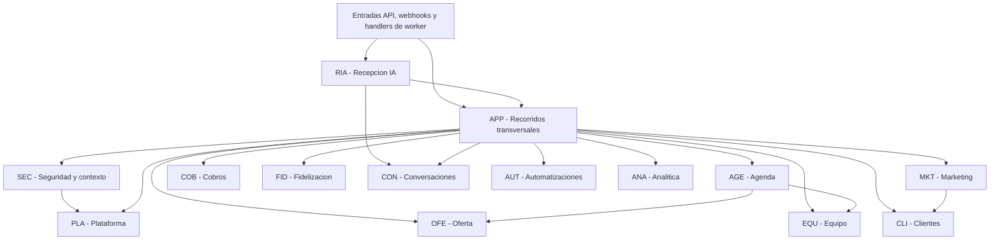

# M0.3 — Límites y dependencias de módulos

Fecha: 26 de octubre de 2026, Ecuador. Estado: **PROPUESTA — PENDIENTE DE REVISIÓN**, salvo elección expresa NestJS/TypeScript. Referencias: [arquitectura](ARCHITECTURE.md), [ejecución](RUNTIME_FLOWS.md) y [ADR](ARCHITECTURE_DECISIONS.md).

## 1. Inventario y convenciones

Los nombres siguientes identifican autoridades lógicas y contratos de aplicación, no archivos NestJS, clases, rutas HTTP o servicios independientes. Se podrán agrupar implementaciones sin fusionar propiedad de datos ni controles. Doce dominios y seis soportes son una organización del mismo monolito, no dieciocho despliegues.

«Dependencia» en la matriz significa uso síncrono de una interfaz pública de otro módulo. Recibir un evento no introduce un import del productor: suscriptores registrados en el ensamblado de entrada traducen eventos a casos de uso. Ninguna interfaz expone repositorios, Prisma o consultas arbitrarias. La publicación durable utiliza el puerto transaccional común; suscriptores no ejecutan negocio antes del commit.

| Dominio | Responsabilidad y mapeo PRD | Requisitos cubiertos |
| --- | --- | --- |
| PLA — Plataforma | Administración SaaS, tenant, acceso y configuración comercial; MOD-12 | FR-MOD12-001 a FR-MOD12-005 |
| CLI — Clientes | CRM, identidad local y consentimiento; MOD-06 | FR-MOD06-001 a FR-MOD06-006 |
| OFE — Oferta | Catálogo, condiciones, valoración y cotización; MOD-04 | FR-MOD04-001 a FR-MOD04-008 |
| EQU — Equipo | Personal, sucursales operativas, recursos y horarios; MOD-03 | FR-MOD03-001 a FR-MOD03-005 |
| AGE — Agenda | Capacidad y ciclo de citas/espera; MOD-02 | FR-MOD02-001 a FR-MOD02-008 |
| COB — Cobros | Dinero y conciliación por ámbito; MOD-05, soporte de cobro a MOD-12 | FR-MOD05-001 a FR-MOD05-006; FR-MOD12-003 |
| FID — Fidelización | Programas y movimientos de beneficios; MOD-09 | FR-MOD09-001 a FR-MOD09-005 |
| CON — Conversaciones | Historial del canal, bandeja humana, control y despacho; MOD-10 y transporte funcional de MOD-01 | FR-MOD10-001 a FR-MOD10-005; FR-MOD01-001 y FR-MOD01-005 |
| AUT — Automatizaciones | Reglas, planificación y seguimiento; MOD-07 | FR-MOD07-001 a FR-MOD07-006 |
| MKT — Marketing | Campañas, audiencias y oferta promocional; MOD-08 | FR-MOD08-001 a FR-MOD08-005 |
| ANA — Analítica | Proyecciones y definiciones de resultados; MOD-11 | FR-MOD11-001 a FR-MOD11-006 |
| RIA — Recepción IA | Intención, contexto y propuestas conversacionales; MOD-01 | FR-MOD01-001 a FR-MOD01-006 |

El mapeo cubre los 71 FR completos; las referencias adicionales muestran colaboración, no doble propiedad. Otras agrupaciones posibles se discutirán sin cambiar autoridades. Las 43 preguntas del producto conservan su estado original.

## 2. Grafo de dependencias de aplicación

Flecha = invoca interfaz pública. No representa colas, causalidad de eventos o red. Puertos de persistencia/adapter/observabilidad se omiten del dibujo para legibilidad y se describen en sección5. No hay flecha APP→RIA: el handler de generación llama RIA, que usa herramientas APP. Un evento no crea una excepción para escribir datos ajenos.

## 3. Contrato común y unidad de trabajo

Cada operación pública requiere contexto confiable: negocio, actor efectivo/originario, alcance de sucursal si aplica, capacidad, identidad de operación, correlación y causa. El contrato compartido incluye solo valores y semánticas de resultado, no reglas comerciales de todos los módulos. El pipeline de aplicación usa SEC para autorización vigente; cada propietario comprueba referencias, tenant e invariantes propios, sin depender de una segunda autenticación remota.

APP coordina operaciones transversales delimitadas —reserva con beneficio, confirmación tras pago, cambio de disponibilidad o cotización vinculada— mediante interfaces que aceptan una **unidad transaccional local opaca**. Solo implementaciones de persistencia del propietario la convierten en acceso DB. No se entregan repositorios ajenos ni se realizan commits autónomos dentro de una operación que promete atomicidad conjunta. Un caso de uso de un dominio puede ejecutarse solo con su propia unidad cuando no necesita coordinación.

En lecturas de configuración relevantes para capacidad, AGE verifica en la unidad final que la versión de OFE/EQU aún sea aplicable. Cambio de configuración y compromiso de agenda usan coordinación persistente compatible; APP no sustituye a AGE decidiendo horarios. Los detalles de aislamiento/bloqueos son pendientes físicos, no se diseñan tablas.

## 4. Dominios

### PLA — Plataforma

- **Responsabilidad principal:** incorporación y configuración del negocio, ciclo de suscripción SaaS y acceso administrativo limitado.
- **Capacidades e interfaces lógicas:** consultar configuración vigente, gestionar incorporación, publicar vista de pertenencias/capacidades, gestionar plan/uso/suscripción y autorizar alcance de soporte. Gestión física de horarios pertenece a EQU.
- **Información administrada:** tenant, vínculo comercial con sucursales, usuarios/membresías y configuración de capacidades, políticas versionadas, plan/límites, estado de suscripción y auditoría de soporte. No almacena saldos de clientes.
- **Dependencias permitidas:** ningún dominio directamente; puertos técnicos de persistencia, auditoría y configuración. APP coordina COB cuando el SaaS necesita cobro.
- **Dependencias prohibidas:** SEC como llamada de vuelta para decidir acceso propio; RIA/AGE/COB para consultar indiscriminadamente datos; proveedor concreto de identidad.
- **Eventos producidos:** NegocioConfigurado, AccesoRevocado, PoliticaPublicada, SuscripcionActualizada y SoporteAutorizado/Revocado.
- **Eventos consumidos:** hechos de cobro SaaS traducidos por handlers a actualización de suscripción, sin aplicar automáticamente política de mora no definida.
- **Operaciones síncronas:** publicar política, revocar acceso, consultar configuración y registrar estado autorizado de suscripción.
- **Operaciones asíncronas:** aviso de vencimiento/incidencia, recepción de resultado de cobro y actualización de métricas de uso.
- **Operaciones críticas e invariantes:** pertenencia y alcance vigentes; revocación efectiva antes de nueva operación sensible; cambio+auditoría+outbox locales; no acceso de soporte indiscriminado.
- **Requisitos vinculados:** FR-MOD12-001 a FR-MOD12-005.
- **Riesgos de acoplamiento:** convertir administración en dueño de todo el negocio o mezclar suscripción SaaS con membresías FID; OQ-PRO-02, OQ-SEC-03 y OQ-BIZ-01/02/03.

### CLI — Clientes

- **Responsabilidad principal:** perfil comercial único por negocio y autoridad de preferencias/consentimiento.
- **Capacidades e interfaces lógicas:** buscar o registrar cliente, resolver duplicado autorizado, consultar perfil/historial pertinente, registrar preferencia/baja y evaluar elegibilidad de contacto/segmento con criterios explícitos.
- **Información administrada:** identidad local, contactos disponibles, preferencias, profesional habitual como referencia, notas permitidas y evidencia de consentimiento/baja; resúmenes comerciales derivados con procedencia y actualización visibles.
- **Dependencias permitidas:** ninguna interfaz de otro dominio; recibirá hechos públicos para su historial por handlers.
- **Dependencias prohibidas:** tablas de citas/pagos para corregirlas; IA como autoridad de consentimiento; asumir identidad global por número.
- **Eventos producidos:** ClienteRegistrado, PerfilCorregido, PreferenciaActualizada y BajaPromocionalRegistrada.
- **Eventos consumidos:** CitaCompletada, PagoVerificado/Devuelto, BeneficioMovido y CampanaContactada para referencias o proyecciones, nunca para convertirse en autoridad financiera.
- **Operaciones síncronas:** búsqueda/alta manual, corrección y baja; consulta autoritativa de permiso de contacto.
- **Operaciones asíncronas:** actualización de resúmenes e historial derivado y resolución de índices de búsqueda si se necesita posteriormente.
- **Operaciones críticas e invariantes:** baja local no espera barrido de cola; referencias pertenecen al mismo tenant; falta de consentimiento no es autorización; datos clínicos excluidos.
- **Requisitos vinculados:** FR-MOD06-001 a FR-MOD06-006; colaboración FR-MOD08-004.
- **Riesgos de acoplamiento:** duplicar historial como fuente de verdad de cobros/citas o interpretar segmento como permiso de envío; OQ-PRO-03, OQ-MKT-01/03, OQ-SEC-01/02.

### OFE — Oferta

- **Responsabilidad principal:** catálogo autorizado, condiciones comerciales, valoración no médica y acuerdo de precio versionado.
- **Capacidades e interfaces lógicas:** consultar oferta vigente, publicar servicio/promoción, obtener condiciones de reserva, configurar valoración, registrar resultado, emitir/revisar cotización y registrar aceptación/rechazo de una versión.
- **Información administrada:** categorías, descripciones/fotos referenciadas, duración/preparación comercial, cuatro modalidades de precio, condiciones/anticipo, combinaciones, valoración y relación a cita/cliente, cotizaciones y evidencia de decisión. EQU posee habilitación operativa del profesional; APP une esa información para catálogo.
- **Dependencias permitidas:** ninguna interfaz de otro dominio; puertos técnicos. APP verifica identidad/referencias y coordina con AGE/COB/FID cuando corresponde.
- **Dependencias prohibidas:** modificar capacidad, cobrar, usar LLM para establecer precio o consultar repositorios privados de EQU.
- **Eventos producidos:** OfertaPublicada, CondicionComercialCambiada, ValoracionRegistrada, CotizacionEmitida/Revisada y CotizacionAceptada/Rechazada.
- **Eventos consumidos:** hechos de atención de valoración para vinculación mediante operación autorizada; no genera precio confirmado automáticamente por completar cita.
- **Operaciones síncronas:** consulta de modalidad, publicación, valoración directa, cotización y aceptación versionada por actor facultado.
- **Operaciones asíncronas:** avisos y actualización de proyecciones tras cambios; no aceptación eventual para aparentar acuerdo inmediato.
- **Operaciones críticas e invariantes:** versión aceptada no se sobrescribe; precio desde/rango no es definitivo salvo garantía; no confundir gratuito con total desconocido; guardar cambio/decisión/auditoría/outbox atómicamente.
- **Requisitos vinculados:** FR-MOD04-001 a FR-MOD04-008; FR-MOD02-008 y FR-MOD06-006 en colaboración.
- **Riesgos de acoplamiento:** mezclar precio aceptado y dinero cobrado o decidir obligatoriedad de valoración sin política; OQ-COM-02 a 08, OQ-PAY-04.

### EQU — Equipo

- **Responsabilidad principal:** capacidad operativa habilitable: personal, especialidades, sucursales físicas, recursos, horarios y ausencias.
- **Capacidades e interfaces lógicas:** registrar personal, consultar configuración operativa vigente, habilitar servicio, modificar horario/ausencia y describir recursos/ubicaciones. APP coordina una modificación que afecta capacidad con AGE.
- **Información administrada:** profesional, habilitaciones, asignación a ubicaciones, horario/descanso/vacaciones/ausencia y recurso con capacidad configurada; no las citas confirmadas.
- **Dependencias permitidas:** ninguna interfaz de otro dominio; recibe del coordinador la operación de cambio ya autorizada, sin recibir permiso para ignorar conflictos.
- **Dependencias prohibidas:** insertar o cancelar citas; modificar catálogo de precios; usar evento eventual como única protección de nueva disponibilidad.
- **Eventos producidos:** PersonalActualizado, DisponibilidadOperativaCambiada y RecursoActualizado.
- **Eventos consumidos:** configuración inicial del negocio a través de operación explícita de incorporación, no clonación de datos privados de PLA.
- **Operaciones síncronas:** consulta operativa y propuesta/aplicación de cambio con versión comprobable.
- **Operaciones asíncronas:** aviso de cambios y seguimiento de citas afectadas después de evaluación por AGE.
- **Operaciones críticas e invariantes:** no habilitar asignación incompatible; cambio que restringe horarios impide nuevas reservas sobre versión antigua; no cancela silenciosamente citas existentes.
- **Requisitos vinculados:** FR-MOD03-001 a FR-MOD03-005; FR-MOD02-001 y FR-MOD02-004.
- **Riesgos de acoplamiento:** EQU recalculando/cambiando citas por fuera de AGE; OQ-AGE-01 y OQ-AGE-03.

### AGE — Agenda

- **Responsabilidad principal:** única autoridad del compromiso de capacidad y ciclo de atención por todos los canales.
- **Capacidades e interfaces lógicas:** consultar disponibilidad, validar/solicitar/retener/confirmar, reagendar/cancelar, registrar finalización/inasistencia, evaluar cambio operativo y administrar espera/ofertas y valoración agendada o directa.
- **Información administrada:** solicitud, cita, asignaciones y ocupación, retenciones/vencimiento, bloqueos, conflictos, estado e historial, preferencias de espera, origen y vínculos a cotización/valoración/cliente. COB mantiene estado de dinero separado.
- **Dependencias permitidas:** lectura pública y versionada de OFE y EQU, dentro de coherencia transaccional necesaria. Cliente y evidencia de beneficio/pago se validan a través de APP y sus propietarios.
- **Dependencias prohibidas:** COB/FID como servicios que AGE invoque recursivamente; LLM, canal, cola, caché o mutex de memoria como autoridad de capacidad.
- **Eventos producidos:** SolicitudRegistrada, RetencionCreada/Expirada, CitaConfirmada/Reagendada/Cancelada/Completada, InasistenciaRegistrada, CapacidadLiberada y ConflictoDetectado.
- **Eventos consumidos:** un pago o cambio operativo entra por caso de uso APP y se vuelve a validar; no consumidor que confirme ciegamente por nombre de evento.
- **Operaciones síncronas:** confirmación, cambio, cancelación y compromiso de capacidad con resultado autoritativo.
- **Operaciones asíncronas:** expiración, evaluación de ofertas de espera y acciones derivadas por handlers; cada comando final vuelve a validar.
- **Operaciones críticas e invariantes:** no sobreventa concurrente; retención vencida no revive; nuevo horario y liberación previa coherentes; capacidadN no se trata como exclusividad; una solicitud sin retención no garantiza horario.
- **Requisitos vinculados:** FR-MOD02-001 a FR-MOD02-008; FL-12, FL-13, FL-16 a FL-19.
- **Riesgos de acoplamiento:** convertirse en orquestador de todo el ciclo comercial o depender de llegada puntual de un job para liberar capacidad; OQ-AGE-01/02/03 y OQ-PAY-01.

### COB — Cobros

- **Responsabilidad principal:** autoridad de solicitudes y hechos monetarios por concepto, receptor y ámbito negocio/SaaS.
- **Capacidades e interfaces lógicas:** registrar intención de cobro, solicitar operación externa mediante puerto, verificar/acreditar evidencia, aplicar a concepto, registrar devolución y conciliar resultado incierto.
- **Información administrada:** importe/moneda autorizados, referencia de operación, evidencia y fuente, estados de solicitud y resultado, pagos parciales/aplicaciones, diferencias, devoluciones y trazabilidad. Precio total desconocido conserva esa condición.
- **Dependencias permitidas:** ninguna interfaz de otro dominio; puerto de pago abstracto para efectos externos fuera de transacción. APP valida concepto/precio con OFE/PLA y decide solicitar a AGE.
- **Dependencias prohibidas:** confirmar cita, alterar cotización o beneficio; inferir éxito de una captura/redirect; asumir proveedor común para SaaS y negocios.
- **Eventos producidos:** SolicitudCobroRegistrada, PagoVerificado, PagoIncierto, PagoFallido, DevolucionSolicitada/Verificada y DiferenciaConciliatoriaDetectada.
- **Eventos consumidos:** ninguna baja/cancelación dispara devolución automática sin política; handler invoca solicitud autorizada con su causa.
- **Operaciones síncronas:** persistir intención, acreditar evidencia válida una vez y consultar estado financiero autoritativo.
- **Operaciones asíncronas:** emisión de enlace, consulta remota, conciliación y devolución; reintento de efecto incierto exige verificar antes.
- **Operaciones críticas e invariantes:** dinero exacto; evidencia única por operación; aplicar pago una vez; devolución no supera alcance autorizado; precio confirmado, aceptado y cobrado separados; no transacción abierta durante pago externo.
- **Requisitos vinculados:** FR-MOD05-001 a FR-MOD05-006; FR-MOD12-003 y FR-MOD11-003 en colaboración.
- **Riesgos de acoplamiento:** fusionar estados de cita y pago, o tratar evento como garantía de horario; OQ-PAY-01 a 04, OQ-INT-02, OQ-COM-05/08.

### FID — Fidelización

- **Responsabilidad principal:** reglas y saldos de puntos, recompensas, cupones de uso, paquetes, membresías y referidos.
- **Capacidades e interfaces lógicas:** consultar elegibilidad/saldo, comprometer/consumir/liberar sesiones o beneficios, acreditar/revertir movimiento y gestionar vigencia/renovación según política.
- **Información administrada:** programas, titular, causas de acreditación, compromisos, consumos, vencimientos, movimientos y relación con cita/cobro/campaña. OFE conserva el precio acordado; MKT comunica campañas.
- **Dependencias permitidas:** ninguna interfaz de otro dominio; APP o handler proporciona causa verificable y contexto, que FID valida contra su estado e identidad de origen.
- **Dependencias prohibidas:** escribir citas/cobros, activar paquetes por texto del LLM o usar una proyección atrasada para autorizar última sesión.
- **Eventos producidos:** BeneficioAcreditado/Comprometido/Consumido/Restituido, PaqueteActivado y MembresiaActualizada.
- **Eventos consumidos:** CitaCompletada o PagoVerificado por handlers de acreditación/activación con política explícita e identidad de causa; duplicados no multiplican saldo.
- **Operaciones síncronas:** redención y compromiso que condiciona una reserva, con transacción conjunta cuando se promete éxito compuesto.
- **Operaciones asíncronas:** puntos poscita, vencimiento y actualización de vistas cuando no condicionan la aceptación de otra operación.
- **Operaciones críticas e invariantes:** saldo reconstruible, no negativo por carrera; un hecho no acredita/consume dos veces; reversión es movimiento, no borrado; renovación por período no se duplica.
- **Requisitos vinculados:** FR-MOD09-001 a FR-MOD09-005.
- **Riesgos de acoplamiento:** descuento calculado distinto en tres dominios o consumo eventual después de prometer paquete reservado; OQ-LOY-01/02/03, OQ-COM-02 y OQ-PAY-03.

### CON — Conversaciones

- **Responsabilidad principal:** registro de mensajes, bandeja humana, propiedad de atención y autoridad local del despacho.
- **Capacidades e interfaces lógicas:** registrar entrada/estado, leer contexto autorizado, asignar/tomar/devolver control, anotar internamente, suspender automatización y registrar/revalidar intención de salida con su versión de control.
- **Información administrada:** conversación por negocio, referencias a cliente y mensajes del proveedor, responsable, estado/control versionado, notas internas, alertas de atención, intenciones/resultados de envío e intentos inciertos.
- **Dependencias permitidas:** ninguna interfaz de otro dominio; APP aporta comprobación vigente de CLI y estado de la operación en la unidad de despacho. Puerto de canal traduce y envía fuera de DB.
- **Dependencias prohibidas:** invocar RIA en respuesta síncrona, decidir precio o capacidad, ignorar baja o permitir adapter que envíe sin puerta final.
- **Eventos producidos:** MensajeEntranteRegistrado, ControlHumanoTomado, AutomatizacionSuspendida, ControlDevuelto, SalidaSolicitada y EstadoMensajeActualizado.
- **Eventos consumidos:** decisiones de atención o resultado de canal por handlers; tareas de RIA/AUT/MKT solo solicitan intenciones, no envían directamente.
- **Operaciones síncronas:** registrar control/pausa, nota, entrada y autorización local del despacho, con versión comprobada.
- **Operaciones asíncronas:** salida externa, recepción de estados, alertas y continuación de procesamiento de entrada por worker.
- **Operaciones críticas e invariantes:** no responder automáticamente sobre control revocado; nota interna no es mensaje público; distinguir job reclamado, envío iniciado, aceptado, entregado e incierto; no prometer retiro de mensaje en vuelo.
- **Requisitos vinculados:** FR-MOD10-001 a FR-MOD10-005; FR-MOD01-001 y FR-MOD01-005.
- **Riesgos de acoplamiento:** estado de pausa duplicado en RIA y bandeja o carrera de salida/baja/humano; AP-01, OQ-EXP-01 y OQ-MKT-01/02.

### AUT — Automatizaciones

- **Responsabilidad principal:** reglas temporales/condicionales, seguimiento de su ejecución y supresión de tareas obsoletas.
- **Capacidades e interfaces lógicas:** configurar/pausar regla, planificar intención desde hecho, evaluar condiciones con hechos vigentes aportados por APP, registrar resultado/fallo/supresión y cancelar lógicamente una ejecución.
- **Información administrada:** regla/versiones, disparador, referencia de causa, propósito, programación, intentos, condición evaluada y resultado. No posee consentimiento, cita ni saldo.
- **Dependencias permitidas:** ninguna interfaz de otro dominio; APP obtiene hechos por interfaces y aplica el efecto en propietario correspondiente.
- **Dependencias prohibidas:** confirmar citas, redimir por SQL, mandar promoción directamente o planificar exclusivamente con memoria del web.
- **Eventos producidos:** AutomatizacionPlanificada/Ejecutada/Suprimida/Fallida y SeguimientoSolicitado.
- **Eventos consumidos:** CitaConfirmada/Reagendada/Cancelada/Completada, ValoracionRegistrada, CotizacionRevisada/Rechazada y CapacidadLiberada según reglas autorizadas.
- **Operaciones síncronas:** edición/pausa y evaluación determinista de condiciones; no toda evaluación necesita un LLM.
- **Operaciones asíncronas:** confirmaciones, recordatorios, poscita, encuesta, reseña, mantenimiento, recuperación, espera y escalamiento. Toda acción se revalida al ejecutarse.
- **Operaciones críticas e invariantes:** una causa/regla no produce efectos duplicados; cita cancelada o propuesta rechazada invalida seguimiento incompatible; baja/control humano prevalecen antes del envío.
- **Requisitos vinculados:** FR-MOD07-001 a FR-MOD07-006; FR-MOD01-004.
- **Riesgos de acoplamiento:** convertir reglas en lenguaje de programación arbitrario o autoridad de todos los dominios; OQ-MKT-01/02, OQ-EXP-01/02, OQ-AGE-02.

### MKT — Marketing

- **Responsabilidad principal:** preparar, programar y medir campañas y sus ofertas comerciales autorizadas.
- **Capacidades e interfaces lógicas:** crear audiencia/segmento por criterio, preparar campaña, asociar oferta/cupón, programar/pausar envíos y consultar historial de acciones.
- **Información administrada:** campaña, criterio y selección de audiencia, contenido/oferta referenciados, programación, resultados de contacto y asociación a reserva. FID autoriza uso de beneficio y CLI decide consentimiento.
- **Dependencias permitidas:** consulta pública de CLI para audiencia/preferencias. APP coordina oferta de OFE, beneficio FID, planificación AUT si se reutiliza regla y despacho CON.
- **Dependencias prohibidas:** guardar una copia de baja que prevalezca sobre CLI, acreditar dinero o saltarse puerta de salida.
- **Eventos producidos:** CampanaProgramada/Pausada, ContactoCampanaSolicitado y CampanaContactada.
- **Eventos consumidos:** resultados de envío, respuestas y reservas vinculadas para historial, con atribución explícita; baja invalida destinatario pendiente pero no depende solo de evento propagado.
- **Operaciones síncronas:** configuración, segmentación autorizada y pausa.
- **Operaciones asíncronas:** ejecución por destinatario, recuperación y resultados; una audiencia calculada antes no autoriza cada mensaje después.
- **Operaciones críticas e invariantes:** ausencia de consentimiento no habilita; nuevo despacho revalida CLI, vigencia, frecuencia y control; reserva manual no se atribuye a IA por recibir campaña.
- **Requisitos vinculados:** FR-MOD08-001 a FR-MOD08-005.
- **Riesgos de acoplamiento:** tener un segundo motor de envío o cupones incongruentes con FID/OFE; OQ-MKT-01/02/03 y OQ-LOY-01.

### ANA — Analítica

- **Responsabilidad principal:** indicadores y proyecciones comerciales/operativas con procedencia y retraso explícitos.
- **Capacidades e interfaces lógicas:** consultar panel de resultados por alcance/período, describir fórmula/cobertura y reconstruir proyección desde hechos autorizados.
- **Información administrada:** proyecciones por tenant, definiciones de indicadores, avance/versión de procesamiento y atribución declarada. Hechos fuente siguen en cada dueño.
- **Dependencias permitidas:** ninguna interfaz de otro dominio directamente. Handlers alimentan hechos públicos; APP puede coordinar una exportación pública de origen para reconstrucción, sin dar SQL privado al consumidor.
- **Dependencias prohibidas:** corregir dinero o capacidad para cuadrar reporte, leer todas las tablas con usuario privilegiado o usar una proyección como aprobación de reserva/pago/redención.
- **Eventos producidos:** ProyeccionActualizada y ProyeccionDesfasada/ReconstruccionSolicitada cuando corresponda.
- **Eventos consumidos:** hechos públicos de conversaciones, citas, cobros, valoraciones/cotizaciones, campañas, automatizaciones y beneficios, deduplicados por causa/versión.
- **Operaciones síncronas:** consulta autorizada de indicadores y estado de actualización.
- **Operaciones asíncronas:** aplicación/reconstrucción de proyecciones y detección de diferencias.
- **Operaciones críticas e invariantes:** observación, atribución y estimación separadas; orientativo/confirmado/cobrado separados; no doble conteo de valoración aplicada o anticipos; estado atrasado visible.
- **Requisitos vinculados:** FR-MOD11-001 a FR-MOD11-006, MET-01 a MET-17.
- **Riesgos de acoplamiento:** convertirse en escritor oculto o acoplar métricas a payloads privados cambiantes; OQ-PRO-03, OQ-MKT-03 y OQ-ARC-03.

### RIA — Recepción IA

- **Responsabilidad principal:** interpretación y conversación comercial, con fuentes autorizadas y herramientas restringidas.
- **Capacidades e interfaces lógicas:** procesar turno, proponer respuesta/acción, pedir aclaración, recomendar oferta y derivar; herramientas consultan o solicitan comandos APP.
- **Información administrada:** intención y estado de turno, versión de prompt/modelo cuando se seleccione, referencias de contexto permitido y resultados de herramientas. CON posee historial, control y envío; RIA no mantiene una pausa alternativa.
- **Dependencias permitidas:** APP para herramientas y CON para contexto público autorizado. Puerto de modelo abstracto, fuera de transacción de DB.
- **Dependencias prohibidas:** Prisma/SQL, cambio de política o precio, envío por adapter directo, inventar disponibilidad o dependencia desde APP hacia RIA.
- **Eventos producidos:** TurnoInterpretado, RespuestaPropuesta y DerivacionSolicitada; son propuestas, no hechos de reserva/cobro.
- **Eventos consumidos:** MensajeEntranteRegistrado mediante handler de generación y resultados de herramientas; control vigente se consulta nuevamente al despachar.
- **Operaciones síncronas:** validación de propuesta y consultas de herramienta; éxito solo tras resultado verificable de APP/dominio.
- **Operaciones asíncronas:** generación por worker, seguimiento permitido planificado por AUT y evaluación de conversaciones.
- **Operaciones críticas e invariantes:** tenant no proviene del modelo; misma identidad de intención no duplica comando; precio desde/rango conserva condición; humano puede suspender; fallo del LLM no bloquea agenda manual.
- **Requisitos vinculados:** FR-MOD01-001 a FR-MOD01-006.
- **Riesgos de acoplamiento:** convertir agente en coordinador central de negocio o framework obligatorio; OQ-SEC-01, OQ-EXP-01, OQ-COM-06 y AP-01.

## 5. Soportes técnicos y de aplicación

Los siguientes soportes son agrupaciones lógicas; no se agrega plataforma operativa externa por nombrarlos.

| Soporte | Responsabilidad, capacidades e información | Interfaces y dependencias permitidas/prohibidas | Síncrono/asíncrono, eventos e invariantes | FR y riesgo de acoplamiento |
| --- | --- | --- | --- | --- |
| APP — Recorridos de aplicación | Casos transversales, correlación e identidad de operación; no dueño de reglas comerciales ni repositorios de todos los dominios | Proporciona ejecutar reserva/cambio/confirmación tras pago/beneficio/valoración/despacho. Invoca dominios y SEC; prohíbe invocar RIA, entradas de transporte o repositorios ajenos | Síncrono: abre unidad local y coordina interfaces; asíncrono: handlers llaman esos mismos casos. Publicación se atribuye al dominio dueño; no evento genérico que sustituya hechos. Evita commits parciales cuando promete éxito conjunto | FR-MOD02-002, FR-MOD05-004/006, FR-MOD09-003; riesgo de módulo gigante: separar casos por recorrido, sin duplicar políticas |
| SEC — Seguridad y contexto | Verifica principal, pertenencia, capacidad, soporte y origen de tarea; contexto derivado, no recibido como autoridad | Proporciona resolver/autorizar contexto. Lee vista pública PLA y puerto de identidad; no escribe datos de negocio ni recibe llamadas de retorno PLA | Síncrono antes de operación y revalidación en worker; fallos de acceso auditables por puerto, sin producir permisos mediante eventos. No cachear indefinidamente una revocación | FR-MOD12-002/004/005; riesgo de confundir autenticación con autorización o bucle PLA↔SEC |
| PER — Persistencia y unidad transaccional | Implementa repositorios privados por dueño, unidad local, recepción durable, outbox y puerto de auditoría | Proporciona atomicidad y acceso limitado a cada dominio; usa Prisma/SQL y PostgreSQL. Prohíbe exponer acceso libre a consumidores o hacer llamadas externas dentro de transacción | Síncrono: cambios+auditoría+outbox. No crea eventos comerciales por su cuenta, persiste los de sus dueños; asíncrono permite leer avance/outbox mediante contratos. Contexto tenant no se fuga entre pools | FR-MOD12-004, FR-MOD02-002, FR-MOD05-002; riesgo de repositorio genérico global que borre límites |
| DUR — Trabajo durable | Publicación outbox, cola pg-boss, planificación, reclamación y resultado de trabajo | Ofrece programar/reintentar/suprimir por handler conocido; maneja puertos de PER y cola; no importa módulos comerciales ni decide pagos. Ensamblado registra handlers de entrada | Asíncrono durable, entrega repetible; señal técnica de fallo/atraso, no hecho financiero. No se promete exactamente una vez; jobs obsoletos se validan en aplicación | FR-MOD07-001, FR-MOD08-003, RNF-04/12; riesgo de usar jobId como única deduplicación de negocio |
| ADA — Adaptadores externos y objetos | Traduce identidad, canal, pago, modelo y almacenamiento; administra referencias de conexión/objeto sin credenciales en dominio | Implementa puertos definidos por sus consumidores, no un servicio universal de negocio; no importa APP/RIA/AGE. Devuelve evidencia/errores, no ejecuta callbacks de negocio ocultos | Entrada webhook se verifica y normaliza; los handlers superiores deciden aplicación. Salidas síncronas de red o asíncronas dirigidas por worker; nunca dentro de DB. Verificar tenant/permiso antes de acceso a archivo | FR-MOD01-001, FR-MOD05-002, FR-MOD04-001, FR-MOD12-001; riesgo de proveedor filtrado a todos los dominios |
| OBS — Observabilidad | Logs, métricas, trazas y redacción; distinto de auditoría de negocio persistida por PER/PLA | Proporciona registro técnico/correlación por puerto, sin llamar dominios ni usar etiquetas con secretos | Exportación eventual y señales de fallo, sin crear eventos de cita/pago; caída de exportador no inventa éxito ni borra auditoría crítica | RNF-08/13/14, FR-MOD11-005; riesgo de datos sensibles y dependencia de APM en camino crítico |

### Eventos y entradas de los soportes

| Soporte | Eventos/entradas consumidos conceptualmente | Salidas producidas y límite de autoridad |
| --- | --- | --- |
| APP | Comandos autorizados y hechos traducidos por handlers, como PagoVerificado o CitaCompletada | Resultados de casos de uso; hechos comerciales producidos por sus dueños, no por un evento genérico del coordinador |
| SEC | Identidad verificada, alcance solicitado y vista vigente de acceso PLA; no depende de recibir evento de revocación para autorizar | Contexto o denegación con señal de auditoría; no crea permisos comerciales por evento |
| PER | Cambios, hechos y evidencia de auditoría de propietarios dentro de unidad local | Commit/rollback y registros durables de outbox; no transforma éxito de escritura en éxito del proveedor |
| DUR | Outbox persistida, programación/cancelación y resultado de handler registrado | Entrega/intento de trabajo y señal técnica de fallo/atraso; no acredita pago o envío |
| ADA | Solicitud autorizada de capacidad externa o webhook con procedencia a comprobar | Evidencia normalizada, referencia, estado externo o error; la aplicación decide si constituye un hecho de negocio válido |
| OBS | Logs, métricas y trazas mínimas de API, trabajador y adapters | Señales/alertas técnicas; no cambia dominios ni reemplaza auditoría comercial |

## 6. Matriz de dependencias permitidas

«—» significa sin dependencia síncrona de dominio. Toda relación no listada está prohibida por defecto y requiere revisión arquitectónica. Puertos técnicos no incorporan implementaciones concretas a dominio. La raíz de composición y los contratos de valores no cuentan como dominios consumidores.

| Consumidor | Interfaz de dominio/soporte de aplicación permitida | Modo | Condición |
| --- | --- | --- | --- |
| Entradas API/webhook/worker | APP; RIA solo en handler de generación | Invocación de caso de uso | Sin acceso directo a repositorios; webhook ya verificado/resuelto |
| RIA | APP; CON lectura pública | Herramienta/consulta | APP no depende de RIA; salida va por caso APP/CON |
| APP | PLA, CLI, OFE, EQU, AGE, COB, FID, CON, AUT, MKT, ANA; SEC | Aplicación síncrona/transacción local | Coordina, no reimplementa invariantes |
| SEC | PLA lectura pública de acceso | Consulta | PLA no llama SEC; contexto común es contrato de valores |
| AGE | OFE y EQU lectura pública versionada | Consulta coherente con compromiso | No cambia datos de esos propietarios |
| MKT | CLI consulta pública | Audiencia/preferencias | Consulta previa no sustituye comprobación al despachar |
| PLA | — | Propiedad local | Cobro SaaS coordinado desde APP |
| CLI | — | Propiedad local | Historial derivado por hechos públicos |
| OFE | — | Propiedad local | Vínculos verificados desde APP |
| EQU | — | Propiedad local | Cambio de capacidad coordinado desde APP/AGE |
| COB | — | Propiedad local y puerto de pago | No confirma citas; no comparte transacción con proveedor |
| FID | — | Propiedad local | No modifica agenda ni dinero |
| CON | — | Propiedad local y puerto de canal | APP comprueba CLI/estado antes de salida |
| AUT | — | Evaluación de reglas | APP aporta hechos vigentes y ejecuta efectos en sus dueños |
| ANA | — | Proyección propia | No escritura privada cruzada; bootstrap mediante exportaciones públicas coordinadas |

Un orden topológico posible del grafo de llamadas, desde consumidores a proveedores, es: Entradas → RIA → APP → {SEC, AGE, MKT, COB, FID, CON, AUT, ANA} → {PLA, OFE, EQU, CLI}. Los elementos en llaves no dependen entre sí salvo aristas explícitas de la matriz. Si una operación solo concierne a un dueño, APP puede limitarse a delegar; no requiere crear un recorrido artificial de doce pasos.

## 7. Eventos, transacciones y control de ciclos

Evento conceptual: hecho con identidad, tenant, productor, objeto/versión, momento, causa/correlación y datos mínimos pertinentes. No se define contrato serializado definitivo. La autoridad lo emite junto con estado/outbox; consumidores usan estado vigente y deduplican por causa/versiones, no por confianza en texto de un webhook.

| Riesgo de ciclo | Resolución propuesta |
| --- | --- |
| AGE→COB→AGE para reserva pagada | APP registra intención y coordina acreditación/confirmación por separado o en unidad local cuando el efecto es enteramente interno; COB no llama AGE |
| AGE→FID→AGE para paquete | APP invoca ambos propietarios en una unidad local; FID no crea/modifica cita |
| RIA→APP→RIA para responder | Handler de worker invoca RIA; herramientas llaman APP; APP devuelve resultado sin invocar modelo |
| CON→RIA→CON para mensaje entrante | CON registra entrada y outbox; un handler superior llama RIA, que consulta CON. CON nunca importa RIA |
| PLA↔SEC para permisos | SEC consulta vista de acceso PLA; PLA usa contexto/valores autorizados y no vuelve a invocar SEC |
| CLI↔MKT para bajas/segmentos | MKT consulta CLI; CLI no llama MKT. Evento invalida pendientes como efecto eventual; puerta final consulta autoridad vigente |
| ANA↔dominios para corregir datos | ANA aplica hechos o pide reconstrucción mediante APP; errores financieros se corrigen por COB, no por reporte |
| DUR→handler→DUR | DUR conoce registro de handlers abstracto, no importa sus módulos; handler de entrada puede solicitar nuevo trabajo con identidad de causa. No reprogramar infinitamente un mismo hecho sin transición válida |

No usar importaciones circulares ni referencias diferidas como mecanismo ordinario para ocultar acoplamiento. Los eventos también pueden formar bucles causales: consumidor que produce otro hecho debe cambiar estado de forma válida, mantener causa y deduplicación; un evento repetido sin transición no emite otro efecto comercial.

## 8. Cambios que requieren revisión

Agregar dependencia no listada, permitir acceso privado cruzado, mover autoridad de capacidad/dinero/consentimiento, introducir transacciones remotas, cambiar tenant o convertir un soporte en servicio de negocio central requiere nuevo ADR/revisión. La revisión física posterior deberá probar estas restricciones, no asumir que los nombres de módulos Nest las hacen efectivas automáticamente. Ninguna dependencia de proveedor o prueba pendiente se presenta aprobada.
