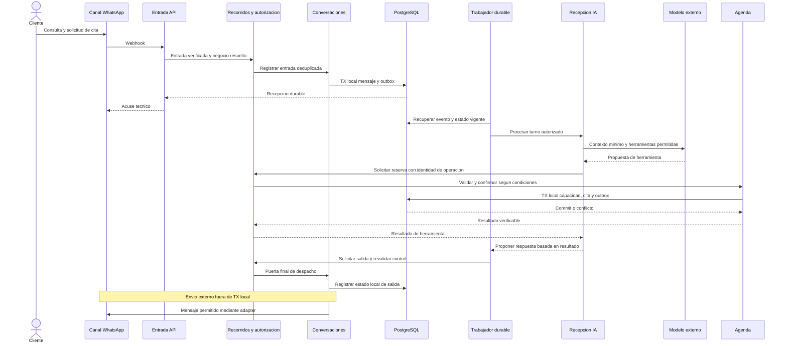
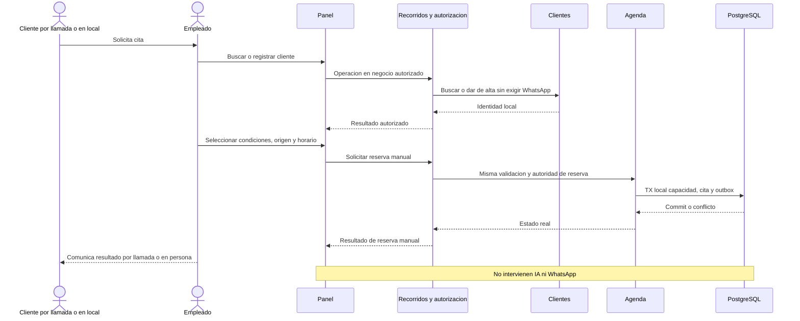
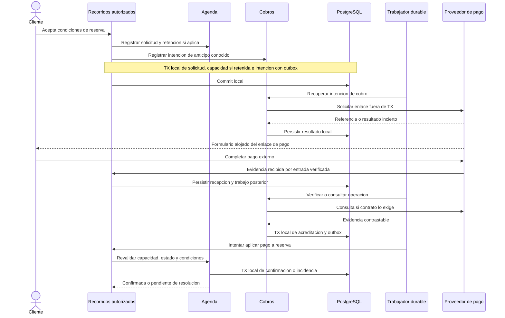
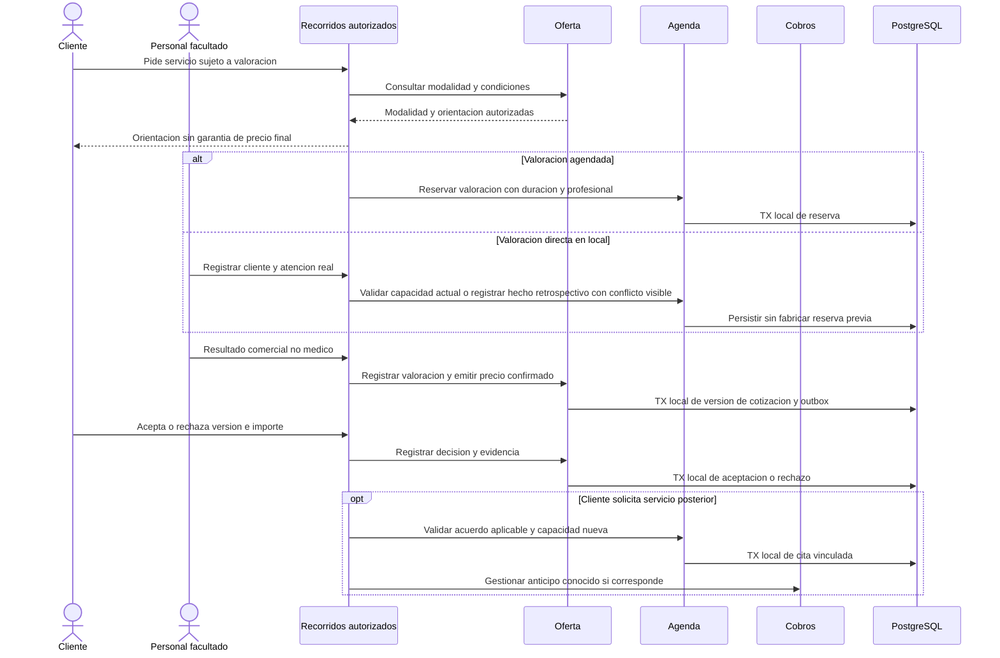
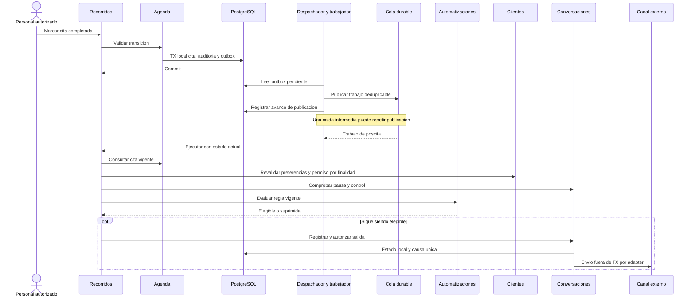
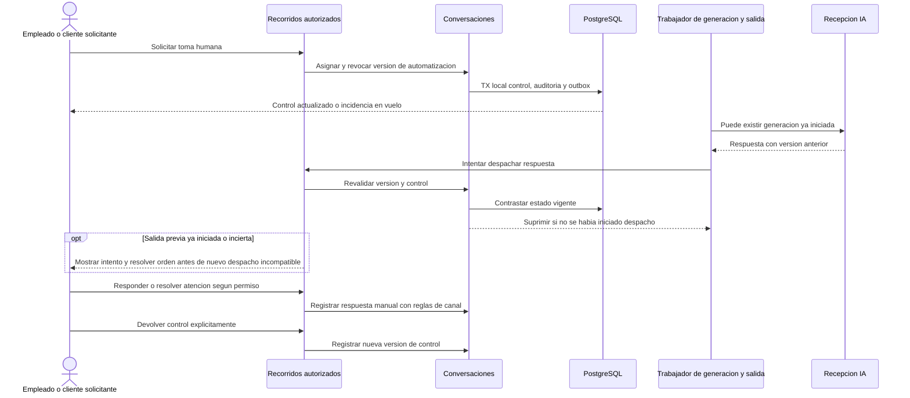
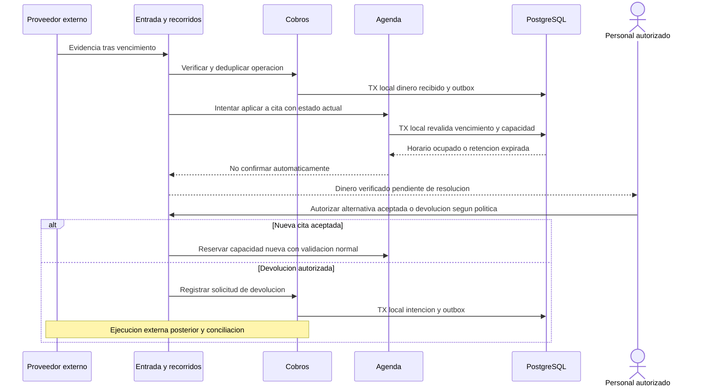
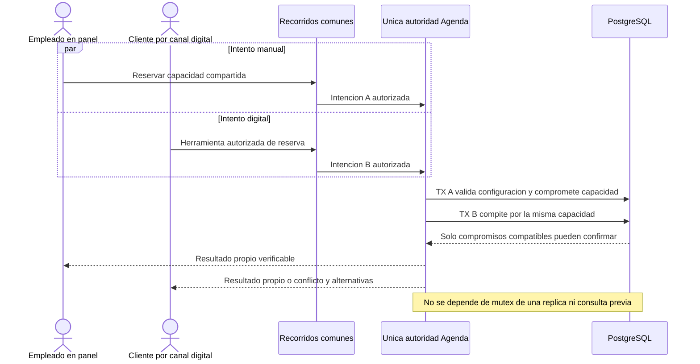

# M0.3 — Flujos críticos de ejecución

Fecha: 26 de octubre de 2026, Ecuador. Estado: **PROPUESTA — PENDIENTE DE REVISIÓN**. Referencias: [arquitectura](ARCHITECTURE.md), [propietarios y dependencias](MODULE_BOUNDARIES.md), [ADR](ARCHITECTURE_DECISIONS.md).

## 1. Convenciones de ejecución

RF identifica un recorrido arquitectónico y no reemplaza los FL funcionales. Nombres de mensajes, eventos y estados son conceptuales; no definen endpoints, tablas o contratos finales. En cada recorrido se conserva tenant, principal efectivo/originario, alcance, identidad de operación, correlación y causa. Cada handler reconstruye autorización y estado vigentes; no reutiliza indefinidamente permisos transportados.

**APP** es Recorridos de aplicación; no es RIA ni una regla de negocio universal. **DB** es persistencia PostgreSQL local; notas «TX» delimitan commit/rollback local, no incluyen nunca Meta, pasarela o LLM. API y worker usan las mismas interfaces de propietarios. Outbox se persiste con el hecho; publicación a pg-boss es posterior y puede repetirse. Los adapters y sus proveedores permanecen provisionales.

Una repetición de la misma intención recupera el resultado o continúa el estado pendiente; misma identidad con datos incompatibles se rechaza. Reintentar no repite sin revisión un efecto externo incierto. Fallos de permiso, política o elegibilidad no son fallos transitorios a repetir ciegamente. Duraciones, umbrales y transiciones finales se resolverán con las preguntas identificadas.

## RF-01 — Reserva desde WhatsApp mediante IA

Vincula FL-01/03, FR-MOD01-001 a 006, FR-MOD02-002 y FR-MOD10-003.

- **Participantes y disparador:** cliente, canal, entrada API, APP/seguridad, CON, RIA/modelo, AGE y trabajador; llega una consulta que puede convertirse en reserva.
- **Validaciones:** procedencia, conexión→tenant, cliente/contexto, control humano vigente, servicio/modalidad, permisos y capacidad real; consentimiento de mensajes según finalidad, no por haber reservado.
- **Pasos síncronos:** recepción durable y acuse; herramienta consulta/ejecuta el mismo caso de uso de AGE que el panel; resultado autoritativo antes de redactar éxito.
- **Pasos asíncronos:** outbox, turno, generación y despacho; un acuse técnico no anuncia reserva.
- **Límite de transacción:** recepción CON y outbox en unidad local; reserva AGE y outbox en otra. Modelo y canal siempre fuera. Si se requiere anticipo, se deriva a RF-03 en lugar de confirmar sin pago.
- **Estado persistido:** entrada y deduplicación, control CON, solicitud/cita o conflicto, origen WhatsApp, resultado de herramienta e intención de salida.
- **Eventos:** MensajeEntranteRegistrado y, si hay éxito, CitaConfirmada; RespuestaPropuesta no es una confirmación alternativa.
- **Errores posibles:** fuente inválida, conexión desconocida, ambigüedad, modelo caído, control humano, precio no confirmado o horario perdido.
- **Reintentos e idempotencia:** entrada repetida no crea otro turno/efecto; herramienta repetida usa identidad comercial; worker relee estado. Un timeout de reserva consulta resultado por identidad antes de repetir intención.
- **Compensaciones:** no deshacer cita válida por fallo del aviso; atención pendiente si no puede comunicarse. No existe compensación textual que convierta operación fallida en éxito.
- **Resultado esperado:** reserva válida o estado no confirmado explicable y respuesta consistente. Recomendaciones/estimaciones no crean precio definitivo.

## RF-02 — Reserva telefónica o presencial registrada por empleado

Vincula FL-16/17, FR-MOD02-006/007, FR-MOD06-001 y FR-MOD12-001.

- **Participantes y disparador:** cliente, empleado, panel, APP/seguridad, CLI y AGE; solicitud por llamada o visita.
- **Validaciones:** identidad/pertenencia/capacidad del empleado, cliente local, referencias autorizadas, modalidad de precio y disponibilidad común. Buscar/crear permite distinguir coincidencias y corregir errores sin transcribir conversación digital.
- **Pasos síncronos:** búsqueda/alta; selección y revisión; confirmación final AGE. Se registran origen y empleado por separado. Si hay anticipo obligatorio, RF-03; si valoración, RF-04.
- **Pasos asíncronos:** solo avisos, historial derivado y métricas posteriores cuando correspondan; sin contacto o permiso no se exige mensajería.
- **Límite de transacción:** alta de cliente puede tener unidad propia; no se elimina un perfil válido por conflicto posterior. Confirmación y capacidad son una unidad local con outbox; si usa beneficio, se coordina RF-09.
- **Estado persistido:** cliente, cita/solicitud, origen teléfono/presencial, autor, condiciones aceptadas y estado real de cobro por separado.
- **Eventos:** ClienteRegistrado si es nuevo, SolicitudRegistrada o CitaConfirmada según resultado.
- **Errores posibles:** cliente ambiguo, dato inválido, servicio deshabilitado, precio pendiente permitido o no según política, conflicto multicanal.
- **Reintentos e idempotencia:** guardar repetidamente la misma intención no crea otra cita; permitir nuevas citas legítimas con otra intención.
- **Compensaciones:** conservar cita anterior si era cambio y el nuevo intento falla; aviso fallido no revierte reserva. No inventar confirmación cuando la plataforma DB está caída.
- **Resultado esperado:** agenda, CRM, cobros, beneficios y reportes funcionan para todos los canales, aun sin IA/WhatsApp configurados o disponibles.

## RF-03 — Reserva con anticipo obligatorio

Vincula FL-02/12 y FR-MOD05-001 a 006. Retención y monto dependen de OQ-PAY-01/04, no de un porcentaje universal.

- **Participantes y disparador:** cliente, APP, AGE, COB, worker y proveedor pendiente; reserva requiere anticipo de concepto/importe autorizado.
- **Validaciones:** permiso, condiciones y capacidad; evidencia de fuente, operación, receptor, moneda e importe; retención vigente y cita aún confirmable. Precio total puede seguir pendiente si el concepto tiene importe conocido válido.
- **Pasos síncronos:** solicitud e intención; al aplicar dinero, nueva validación AGE. Una solicitud de cobro no equivale a dinero ni a reserva confirmada.
- **Pasos asíncronos:** enlace, recepción de evidencia, consulta/confirmación remota exigida por producto, aplicación posterior y avisos.
- **Límite de transacción:** unidad inicial puede coordinar solicitud/retención e intención local COB; acreditación es durable e independiente de confirmación posterior. Ninguna TX espera pago del cliente o respuesta de pasarela.
- **Estado persistido:** solicitud y retención si corresponde; pago solicitado/verificado/fallido/incierto; saldo o total aún no definido; cita confirmada o incidencia de aplicación.
- **Eventos:** SolicitudCobroRegistrada, PagoVerificado o PagoIncierto y CitaConfirmada solo tras AGE.
- **Errores posibles:** emisión incierta, monto discordante, duplicado, falta de pago, expiración, cancelación entre pago y aplicación o capacidad perdida sin retención.
- **Reintentos e idempotencia:** no recrear cargo por timeout sin consultar; deduplicar evidencia y aplicación por causa; verificar si hubo cobro real duplicado, distinto de webhook repetido.
- **Compensaciones:** alternativa de horario aceptada o devolución autorizada si no se puede aplicar; devolución se informa pendiente hasta evidencia. No borrar dinero ni desplazar citas.
- **Resultado esperado:** ninguna cita confirmada por evidencia no verificada y ningún pago tardío crea sobreventa; dinero recibido queda conciliable aunque la reserva no confirme.

## RF-04 — Valoración, cotización y reserva posterior

Vincula FL-18/19, FR-MOD04-006 a 008, FR-MOD02-008 y FR-MOD05-006.

- **Participantes y disparador:** cliente, personal facultado, APP, OFE, AGE y COB si hay cobro; servicio depende de valoración presencial.
- **Validaciones:** cuatro modalidades, garantía explícita si existe, facultad para confirmar/modificar precio, titular y versión, duración/profesional de valoración. Gratuidad/cobro/descuento posterior y obligatoriedad dependen de OQ-COM-04/05/06/07/08.
- **Pasos síncronos:** configurar/consultar valoración; registrar resultado no médico; confirmar cotización; registrar decisión explícita; solicitar nueva cita con capacidad revalidada.
- **Pasos asíncronos:** enlace/cobro de valoración, avisos permitidos, seguimiento de propuesta pendiente y métricas de conversión; completar valoración no completa servicio posterior.
- **Límite de transacción:** cada hecho de valoración/cotización/aceptación es local y versionado; no se mantiene TX mientras cliente decide. Reserva posterior es nueva unidad AGE, preservando valoración aunque no haya conversión.
- **Estado persistido:** orientativo comunicado, precio confirmado y versión, evidencia de aceptación/rechazo, vínculo cliente/servicio/valoración/cita/pago y cobro efectivamente verificado aparte.
- **Eventos:** ValoracionRegistrada, CotizacionEmitida/Revisada/Aceptada/Rechazada y, si procede, CitaConfirmada.
- **Errores posibles:** cotización revisada mientras se acepta, precio fuera de rango garantizado, profesional no facultado, no continuación, saldo o anticipo incierto.
- **Reintentos e idempotencia:** misma decisión de versión no se registra como otra aceptación; aceptar versión obsoleta requiere presentar propuesta vigente. Repetir valoración registrada no crea atención ficticia.
- **Compensaciones:** nueva propuesta y aceptación para cambiar acuerdo existente; cancelar según política y revisar importes parciales. Descontar valoración solo si está autorizado, sin contar dinero dos veces.
- **Resultado esperado:** valoración gratuita/pagada, agendada/directa y posible servicio posterior trazables, sin sustituir precio desconocido por cero ni aceptación por pago.

## RF-05 — Poscita mediante outbox y trabajador

Vincula FL-05/06/07, FR-MOD07-001 a 006 y FR-MOD09-001.

- **Participantes y disparador:** personal, APP, AGE, outbox/cola/worker, AUT, CLI, CON y canal; cita efectivamente completada activa regla.
- **Validaciones:** estado aún válido, regla/versión vigente, datos suficientes, finalidad y consentimiento, frecuencia, pausa y ausencia de ejecución equivalente. Valoración no es tratamiento completado.
- **Pasos síncronos:** transición AGE con resultado local; evaluación y puerta final de salida cuando se ejecute trabajo.
- **Pasos asíncronos:** publicación, programación, poscita, encuesta/reseña, mantenimiento o nueva propuesta; experiencia negativa crea pendiente humano y respuesta no recibida no se inventa.
- **Límite de transacción:** cita+auditoría+outbox locales; publicación a cola no comparte commit por defecto; cada ejecución/intención de salida tiene su unidad. El canal queda fuera.
- **Estado persistido:** causa de regla, programación, intento, supresión/fallo/resultado, estado de cita y salida correlacionada.
- **Eventos:** CitaCompletada, AutomatizacionPlanificada/Ejecutada/Suprimida y EstadoMensajeActualizado; beneficios se acreditan por FID mediante handler propio cuando corresponda.
- **Errores posibles:** caída entre publicar y avanzar, cita corregida, baja, falta de contacto, pausa humana, regla desactivada o fallo del canal.
- **Reintentos e idempotencia:** repetición de evento/job no crea otra recompensa ni intención equivalente; revalidar en vez de enviar contenido de programación antigua.
- **Compensaciones:** suprimir tarea obsoleta; una cita válida no se descompleta por caída de mensajería; queja se escala. Mensaje ya enviado no se borra por una nueva baja.
- **Resultado esperado:** contacto útil autorizado y rastreable, o no envío con causa explícita, sin depender de memoria del proceso web.

## RF-06 — Transferencia de IA a humano

Vincula FL-11 y FR-MOD10-001 a 005; aplica AP-01 y OQ-EXP-01.

- **Participantes y disparador:** cliente/personal, APP, CON, DB, worker y RIA; petición humana, excepción, información ausente o experiencia negativa.
- **Validaciones:** permiso de tomar/asignar/responder, pertenencia a conversación, responsable y versión actual de control; retorno explícito y políticas del canal.
- **Pasos síncronos:** guardar toma/pausa y responsable o cola; invalidar autorización de respuestas aún no despachadas. Notas internas se mantienen separadas de mensajes públicos.
- **Pasos asíncronos:** alertar pendiente y suprimir trabajos atrasados; la verificación final protege incluso si no se canceló físicamente un job.
- **Límite de transacción:** control, auditoría e invalidación local de intención coordinados; no esperar LLM o canal manteniendo TX.
- **Estado persistido:** modo/control versionado, responsable, pausa por finalidad, intentos pendientes/en vuelo, motivo y devolución a IA.
- **Eventos:** ControlHumanoTomado, AutomatizacionSuspendida y ControlDevuelto.
- **Errores posibles:** no hay personal, dos empleados toman control, respuesta generada con versión antigua, envío previo ya aceptado o incierto.
- **Reintentos e idempotencia:** tomar control repetido no reactiva IA; nueva entrada no revoca pausa; despacho con versión antigua se suprime. Carrera se resuelve con coordinación persistente, no flag de proceso.
- **Compensaciones:** pendiente visible si falla asignación; no prometer retractar un mensaje externo iniciado. Resolver/drenar intento previo antes de salida incompatible según política por definir, sin disfrazar incertidumbre como entrega.
- **Resultado esperado:** humano controla conversación y la IA no compite con nueva salida automática. El límite del mensaje en vuelo se muestra expresamente; no se promete atención humana inmediata ni retiro remoto garantizado.

## RF-07 — Pago tardío, repetido o de resultado incierto

Vincula FL-12 y FR-MOD05-002/004/005.

- **Participantes y disparador:** proveedor, entrada/APP, COB, AGE y personal; evidencia repetida/tardía o timeout después de solicitar pago.
- **Validaciones:** comercio/tenant y fuente confiables, importe/moneda, identidad externa y local, cita y vigencia; nueva propuesta requiere aceptación y política.
- **Pasos síncronos:** acreditar evidencia única; intentar aplicación con AGE; devolver estado diferenciado. Expiración y confirmación compiten en DB, no por orden de recepción aparente.
- **Pasos asíncronos:** consulta externa ante incertidumbre, conciliación, avisos, devolución solicitada y verificación posterior.
- **Límite de transacción:** dinero recibido y su outbox persisten aunque no haya capacidad; nueva cita o intención de devolución en otra unidad local. Nunca TX remota.
- **Estado persistido:** referencia de evidencia, dinero recibido/fallido/incierto, cita expirada/no confirmada y resolución pendiente; devolución solicitada no verificada aún.
- **Eventos:** PagoVerificado/PagoIncierto y DiferenciaConciliatoriaDetectada; DevolucionVerificada solo con evidencia.
- **Errores posibles:** doble notificación, doble cobro real, callback fuera de orden, reserva cancelada, proveedor sin consulta disponible o devolución incierta.
- **Reintentos e idempotencia:** repetir evidencia no acredita más; consulta no crea cargo; no repetir cobro/devolución incierta sin comprobar resultado. Si evidencia falta, intervención con limitaciones explícitas.
- **Compensaciones:** reprogramación aceptada o devolución permitida; nunca desplazar cita ajena, alterar importe histórico o prometer devolución por texto.
- **Resultado esperado:** ni doble reserva ni dinero perdido del registro; incidencia y resolución auditables aun con fallo parcial.

## RF-08 — Reserva concurrente entre canales

Vincula FL-13, RN-01/26 y FR-MOD02-001/002/007.

- **Participantes y disparador:** dos solicitantes/canales, APP, AGE y DB; ambos observaron antes un horario aparentemente libre.
- **Validaciones:** contexto e identidad independientes, misma capacidad real, duración/preparación, estado de recursos, versiones de configuración y condiciones vigentes.
- **Pasos síncronos:** cada intención usa confirmación única AGE; DB respalda el invariante concurrente. No se preasigna ganador por canal.
- **Pasos asíncronos:** avisos y alternativas/lista de espera posteriores al resultado; no se decide capacidad por un job que llega más tarde.
- **Límite de transacción:** cada intento tiene unidad local; la coordinación/restricción aplicable protege al conjunto frente a replicas concurrentes. CapacidadN admite solo asignaciones compatibles, no necesariamente un único ganador.
- **Estado persistido:** compromisos válidos y resultado de intención; conflicto o solicitud pendiente para perdedor, no cita confirmada falsa.
- **Eventos:** CitaConfirmada/RetencionCreada para éxito; ConflictoDetectado y eventual oferta de espera.
- **Errores posibles:** conflicto, serialización/deadlock, timeout con resultado desconocido o cambio de horario del profesional concurrente.
- **Reintentos e idempotencia:** consultar identidad para recuperar commit incierto; reintentar transacción completa solo si error lo permite; no crear otra reserva ni cambiar a otro horario sin aceptación.
- **Compensaciones:** ninguna sobre cita ajena; si hubo dinero previo y no se puede aplicar, RF-07.
- **Resultado esperado:** no sobreventa aunque haya varias réplicas, canales y consultas desactualizadas. Mecanismo físico se decidirá con OQ-AGE-01, sin SQL definitivo aquí.

## RF-09 — Paquete, redención y reversión

Vincula FL-09 y FR-MOD09-001 a 005. No se requiere diagrama adicional: la secuencia usa APP→AGE/FID/COB según la matriz.

- **Participantes y disparador:** cliente/personal, APP, FID, AGE y COB si hay compra; compra de paquete o uso de una sesión/beneficio.
- **Validaciones:** identidad local y titularidad, pago verificado cuando el paquete lo requiere, vigencia, elegibilidad de servicio, saldo y política de compromiso/consumo/restitución (OQ-LOY-01/02/03).
- **Pasos síncronos:** comprar registra intención en COB; activar requiere evidencia; reservar con beneficio consulta y compromete saldo en FID y capacidad en AGE mediante APP cuando ambos deben aceptarse juntos.
- **Pasos asíncronos:** acreditaciones por hecho elegible, renovación y vencimiento cuando no condicionan confirmación inmediata, con su propia validación transaccional.
- **Límite de transacción:** reserva+compromiso de sesión y outbox locales si se promete éxito conjunto; fallo en cualquier dueño revierte esa unidad. El cobro remoto queda separado y puede exigir resolución, no rollback imaginario.
- **Estado persistido:** compra/pago, paquete activo o pendiente, saldo, compromiso/consumo con cita y movimientos de reversión.
- **Eventos:** PaqueteActivado, BeneficioComprometido/Consumido/Restituido; puntos por visita usan causa única del hecho elegible.
- **Errores posibles:** última sesión concurrente, pago pendiente, beneficio vencido, cancelación, inasistencia o evento repetido.
- **Reintentos e idempotencia:** FID comprueba saldo y causa dentro de TX; repetir finalización no duplica consumo ni puntos. Proyecciones de saldo no autorizan gasto.
- **Compensaciones:** liberación/restitución según política mediante movimiento auditable; no borrar consumo o devolver dinero automáticamente si la política no está definida.
- **Resultado esperado:** capacidad y beneficio coherentes, sin saldo negativo ni doble uso; momento exacto de consumo no se decide arbitrariamente.

## RF-10 — Baja y campaña ya programada

Vincula FL-08/14, FR-MOD06-005, FR-MOD08-003/004 y FR-MOD07-006.

- **Participantes y disparador:** cliente/personal, CLI, APP, MKT/AUT, worker y CON; el destinatario solicita baja después de ser seleccionado para una campaña.
- **Validaciones:** identidad y alcance de baja; si es ambigua, suspensión precautoria promocional mientras se aclara; canal/origen de reserva no presume permiso.
- **Pasos síncronos:** CLI registra baja, origen y momento con nueva condición vigente; APP/CON la consultan en puerta final antes de despacho, coordinada con control y frecuencia.
- **Pasos asíncronos:** evento invalida audiencia y cancela lógicamente jobs pendientes. Suprimir en aplicación es obligatorio aunque el barrido de cola falle o el job ya esté reclamado.
- **Límite de transacción:** baja y outbox locales; autorización de salida y estado CON se coordinan contra preferencia vigente; no es una transacción con proveedor.
- **Estado persistido:** evidencia de baja, intento bloqueado/suprimido y cualquier mensaje cuyo despacho ya se inició como tal, no como entregado.
- **Eventos:** BajaPromocionalRegistrada, AutomatizacionSuprimida y resultado de contacto de campaña sin fingir envío.
- **Errores posibles:** evento de baja atrasado, mensaje en vuelo, preferencia duplicada o fallo de DB al registrar baja. No confirmar éxito ficticio; mantener pendiente/bloqueo para resolver solicitud.
- **Reintentos e idempotencia:** repetir baja no reactiva consentimiento; un job antiguo consulta autoridad CLI y no una copia de audiencia. Nueva autorización requiere evidencia, no una nueva cita.
- **Compensaciones:** no se retira mensaje que el proveedor ya aceptó; el usuario ve el estado y no se inician promociones posteriores incompatibles. Riesgo del intervalo control/I-O y su semántica de efectividad se registran en AP-01, no se ocultan como garantía remota.
- **Resultado esperado:** baja efectiva en autoridad comercial y ausencia de nuevos despachos no elegibles; mensajes operativos se evalúan por finalidad, sin ocultar promoción dentro de ellos.

## RF-11 — Cambio de disponibilidad o configuración reservable

Vincula FL-10 y FR-MOD03-002 a 005; afecta también cambios de duración/servicio de OFE.

- **Participantes y disparador:** profesional/administrador, APP, EQU u OFE, AGE y personal de atención; cambio de ausencia, horario, recurso o condición reservable.
- **Validaciones:** permisos y sucursal, versión actual, citas afectadas, habilitación y coherencia de duración/recursos. No cancelar o trasladar cita silenciosamente.
- **Pasos síncronos:** APP coordina cambio propietario y evaluación/restricción de nuevas reservas por AGE con la misma frontera de coherencia de disponibilidad; muestra conflictos para resolución.
- **Pasos asíncronos:** avisos y propuestas a clientes afectados, aceptadas y ejecutadas después mediante reagendamiento normal.
- **Límite de transacción:** cambio que restringe nueva disponibilidad y mecanismo de versión/validación AGE deben ser coherentes inmediatamente; evento eventual no es la única protección. Reagendar cada cita mantiene nueva asignación y anterior en una unidad local.
- **Estado persistido:** configuración versionada, alcance de cambio, conflictos y citas anteriores conservadas hasta resolución válida.
- **Eventos:** DisponibilidadOperativaCambiada/CondicionComercialCambiada, ConflictoDetectado y posteriores CitaReagendada/Cancelada si se autorizan.
- **Errores posibles:** modificación concurrente y reserva confirmándose sobre versión vieja, permisos insuficientes, falta de reemplazo o fallo parcial de avisos.
- **Reintentos e idempotencia:** conflicto de versión exige recargar y validar; repetir cambio no cancela citas dos veces. Coordinación persistente y orden de acceso a recursos se especificarán físicamente con OQ-AGE-01.
- **Compensaciones:** conservar citas y escalar atención; no revertir hechos del servicio ya completado ni esconder un registro retrospectivo conflictivo.
- **Resultado esperado:** nuevas reservas respetan disponibilidad vigente mientras las existentes tienen resolución visible y trazable.

## RF-12 — Suscripción SaaS y cobro propio de plataforma

Vincula FR-MOD12-003/005, diferente de pago del cliente y de membresía FID.

- **Participantes y disparador:** propietario, APP, PLA, COB, worker y proveedor pendiente; alta/renovación/cambio de plan o evidencia de su cobro.
- **Validaciones:** titular/permisos, plan/uso y política aprobados; ámbito SaaS, moneda, receptor de plataforma y evidencia vinculada, sin reutilizar comercio receptor del establecimiento.
- **Pasos síncronos:** PLA registra elección/estado según política, COB intención; hechos verificados actualizan suscripción mediante caso APP autorizado.
- **Pasos asíncronos:** cobro, consulta, conciliación y avisos. Recurrencia automática solo si se aprueba y habilita, no por existir tokenización.
- **Límite de transacción:** intención y cambios locales relacionados se coordinan; efecto externo separado; aplicar período una vez con evidencia y política.
- **Estado persistido:** plan elegido, uso, estado de suscripción, período y referencia a operación de cobro; no importe definitivo del SaaS inventado.
- **Eventos:** SolicitudCobroRegistrada en ámbito SaaS, PagoVerificado y SuscripcionActualizada.
- **Errores posibles:** notificación repetida, pago fallido/tardío, cambio de plan concurrente, suspensión con citas/pagos de clientes aún pendientes.
- **Reintentos e idempotencia:** evento no acredita período dos veces; recuperación de consulta antes de recobro incierto; permisos/estado de tenant vigentes en worker.
- **Compensaciones:** resolver pendiente o restitución bajo política; no suspender indiscriminadamente acceso necesario para resolver operaciones sin decisión OQ-BIZ-03.
- **Resultado esperado:** cobro SaaS aislado conceptualmente de cobros del negocio, con política de plan/mora sin cerrar arbitrariamente y sin proveedor seleccionado.

## RF-13 — Reportes y reconstrucción de proyecciones

Vincula FL-15, FR-MOD11-001 a 006 y MET-15 a MET-17.

- **Participantes y disparador:** propietario autorizado, APP/seguridad, ANA, workers y productores de hechos; consulta de panel o llegada de evento para proyección.
- **Validaciones:** tenant y sucursal, acceso financiero, definición/período, versión del hecho y avance de proyección.
- **Pasos síncronos:** consulta devuelve indicadores y momento/cobertura actualizados, diferenciando observación, atribución y estimación; para estado operacional autoritativo se consulta dueño mediante caso específico, no proyección.
- **Pasos asíncronos:** ANA aplica hechos públicos deduplicados; reconstrucción usa exportaciones autorizadas por interfaces de propietarios, coordinadas desde APP, sin acceso privilegiado libre a tablas ajenas.
- **Límite de transacción:** aplicación de hecho y avance local de proyección son coherentes; no existe transacción global entre todas las visitas/cobros para cada consulta de dashboard.
- **Estado persistido:** proyección por negocio, definición/criterio, causas procesadas y estado de actualización/reconstrucción.
- **Eventos:** hechos públicos de cita, valoración/cotización, dinero, conversación, campaña y beneficio; ProyeccionActualizada/Desfasada.
- **Errores posibles:** evento repetido, antiguo o faltante, proyección parcial, denominador cero o identidad de cliente corregida.
- **Reintentos e idempotencia:** aplicar causa/versión una vez; detectar huecos y reconstruir; no sumar otro anticipo ni clasificar valoración como tratamiento por repetir entrega.
- **Compensaciones:** corregir/reconstruir vista, nunca cambiar dinero/citas para cuadrar reporte. Correcciones fuente se tramitan por dueño con evidencia.
- **Resultado esperado:** totales por origen y etapas monetarias interpretables; retraso visible y ninguna atribución causal automática de ingresos a IA.

## 2. Verificaciones comunes de los recorridos

Se debe probar posteriormente cada recorrido con permiso inválido, tenant ajeno, callback/job repetido, reinicio, cambio de estado entre programación y ejecución y resultado externo incierto. Los diagramas no representan un mutex de proceso ni transacción distribuida. Los ocho diagramas de secuencia de este documento, junto a los cuatro flowcharts de los otros dos documentos, forman los doce diagramas de la entrega.

Son diseños de ejecución, no pruebas realizadas. Las dudas de políticas, punto de efectividad de pausa/baja, capacidad compuesta y composición de versiones se conservan en ARCHITECTURE y ADR. No se usa esta documentación para declarar sistema listo para dinero o clientes reales.
